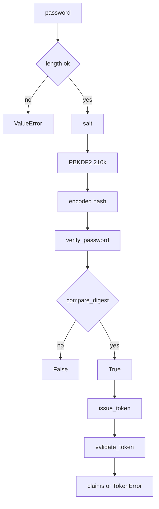

---
# MAM Metadata
id: template-example-auth
name: Authentication Primitives
version: 2.0.0
type: module

author: MAM Team

description: >
  Password hashing and signed session tokens built only on the Python standard
  library: PBKDF2-HMAC-SHA256 hashes, constant-time verification, HMAC signed
  tokens with expiry and audience checks, and a single entry point that runs the
  whole flow.

license: MIT

runtime:
  language: python
  version: ">=3.12"

tags:
  - template
  - example
  - auth
  - security

dependencies: []

capabilities:
  - hash_password
  - verify_password
  - issue_token
  - validate_token

permissions:
  filesystem:
    - read
---

# Authentication Primitives

## Purpose

Authentication code is easy to write and hard to write safely. This module is a
small, auditable reference: it hashes passwords with PBKDF2-HMAC-SHA256 and a
per-password salt, verifies them in constant time, and issues stateless session
tokens signed with HMAC-SHA256. It deliberately has no dependencies outside the
Python standard library, so the security properties are visible in one file.

The module is a building block, not a complete identity provider. It does not
store users, send email, rate limit login attempts or manage refresh tokens.
Those concerns belong to the service that embeds it.

## Inputs

| Name | Type | Required | Description |
|------|------|----------|-------------|
| password | string | Yes | Plaintext password to hash or verify |
| encoded | string | Yes | Stored hash in `pbkdf2_sha256$iterations$salt$digest` form |
| subject | string | Yes | Stable user identifier embedded in a token |
| secret | string | Yes | HMAC signing secret, at least 32 bytes |
| ttl_seconds | integer | No | Token lifetime, defaults to 900 |
| audience | string | No | Expected token audience, defaults to `mam` |
| now | number | No | Unix timestamp, injectable for tests |

## Outputs

| Name | Type | Description |
|------|------|-------------|
| hash | string | Versioned password hash with algorithm, iterations and salt |
| valid | boolean | Whether a password matches a stored hash |
| token | string | `payload.signature` base64url token |
| claims | object | Decoded and verified token claims |
| expires_at | integer | Unix timestamp when the token stops being valid |

## Capabilities

### hash_password

Derive a 32-byte key from the password, a 16-byte random salt and 210,000
PBKDF2 iterations, then encode algorithm, iterations, salt and digest in one
self-describing string.

### verify_password

Recompute the digest from the presented password and the stored salt, then
compare with `hmac.compare_digest` so timing does not leak the prefix.

### issue_token

Serialise the claims as canonical JSON, base64url-encode them and sign with
HMAC-SHA256. The signature never covers a secret; it only covers the payload.

### validate_token

Recompute the signature, reject a mismatch, parse the claims and enforce
expiry, not-before and audience before returning them.

## Rules

- Never compare password digests with `==`; always use `hmac.compare_digest`.
- A stored hash is self-describing: algorithm, iterations, salt and digest.
- `secret` shorter than 32 bytes is rejected, never silently padded.
- Tokens are rejected when expired, unsigned, malformed or for another audience.
- `ttl_seconds` must be positive; `0` and negatives are rejected.
- Plaintext passwords and secrets never appear in logs or return values.
- Verification of a malformed stored hash returns `False`, never raises.

## Workflow



## Python

```python
import base64
import hashlib
import hmac
import json
import secrets
import time
from typing import Any, Dict, Optional

ALGORITHM = "pbkdf2_sha256"
PBKDF2_ITERATIONS = 210_000
SALT_BYTES = 16
DIGEST_BYTES = 32
TOKEN_TTL_SECONDS = 900
MIN_SECRET_BYTES = 32


class TokenError(ValueError):
    """Raised when a token is malformed, tampered with or expired."""


def _b64url(data: bytes) -> str:
    return base64.urlsafe_b64encode(data).rstrip(b"=").decode("ascii")


def _unb64url(value: str) -> bytes:
    padding = "=" * (-len(value) % 4)
    return base64.urlsafe_b64decode(value + padding)


def _derive(password: str, salt: bytes, iterations: int) -> bytes:
    return hashlib.pbkdf2_hmac("sha256", password.encode("utf-8"), salt, iterations, DIGEST_BYTES)


def hash_password(password: str, salt: Optional[bytes] = None,
                  iterations: int = PBKDF2_ITERATIONS) -> str:
    """Return a self-describing PBKDF2-SHA256 hash."""
    if not isinstance(password, str) or password == "":
        raise ValueError("password must be a non-empty string")
    if iterations < 10_000:
        raise ValueError("iterations must be at least 10000")
    salt = salt if salt is not None else secrets.token_bytes(SALT_BYTES)
    digest = _derive(password, salt, iterations)
    return f"{ALGORITHM}${iterations}${_b64url(salt)}${_b64url(digest)}"


def verify_password(password: str, encoded: str) -> bool:
    """Constant-time check of a password against a stored hash."""
    if not isinstance(encoded, str):
        return False
    parts = encoded.split("$")
    if len(parts) != 4 or parts[0] != ALGORITHM:
        return False
    try:
        iterations = int(parts[1])
        salt = _unb64url(parts[2])
        expected = _unb64url(parts[3])
    except (ValueError, TypeError):
        return False
    if iterations < 10_000:
        return False
    candidate = _derive(password, salt, iterations)
    return hmac.compare_digest(candidate, expected)


def _sign(body: str, secret: str) -> str:
    if not isinstance(secret, str) or len(secret.encode("utf-8")) < MIN_SECRET_BYTES:
        raise ValueError(f"secret must be at least {MIN_SECRET_BYTES} bytes")
    return _b64url(hmac.new(secret.encode("utf-8"), body.encode("ascii"), hashlib.sha256).digest())


def issue_token(subject: str, secret: str, ttl_seconds: int = TOKEN_TTL_SECONDS,
                audience: str = "mam", now: Optional[float] = None) -> str:
    """Issue an HMAC-SHA256 signed token for one subject."""
    if not isinstance(subject, str) or not subject.strip():
        raise ValueError("subject must be a non-empty string")
    if ttl_seconds <= 0:
        raise ValueError("ttl_seconds must be positive")
    issued = int(time.time() if now is None else now)
    claims = {
        "sub": subject,
        "aud": audience,
        "iat": issued,
        "exp": issued + int(ttl_seconds),
        "jti": secrets.token_hex(8),
    }
    body = _b64url(json.dumps(claims, separators=(",", ":"), sort_keys=True).encode("utf-8"))
    return f"{body}.{_sign(body, secret)}"


def validate_token(token: str, secret: str, audience: str = "mam",
                   now: Optional[float] = None) -> Dict[str, Any]:
    """Verify a token and return its claims, or raise TokenError."""
    if not isinstance(token, str) or token.count(".") != 1:
        raise TokenError("malformed token")
    body, signature = token.split(".", 1)
    try:
        expected = _sign(body, secret)
    except ValueError as exc:
        raise TokenError(str(exc)) from exc
    if not hmac.compare_digest(signature, expected):
        raise TokenError("signature mismatch")
    try:
        claims = json.loads(_unb64url(body).decode("utf-8"))
    except (ValueError, UnicodeDecodeError) as exc:
        raise TokenError("malformed payload") from exc
    current = int(time.time() if now is None else now)
    if not isinstance(claims, dict) or "exp" not in claims or "sub" not in claims:
        raise TokenError("missing claims")
    if claims.get("aud") != audience:
        raise TokenError("audience mismatch")
    if current >= int(claims["exp"]):
        raise TokenError("token expired")
    if current < int(claims.get("iat", 0)):
        raise TokenError("token not yet valid")
    return claims


def run(password: str, secret: str, now: Optional[float] = None) -> Dict[str, Any]:
    """Hash a password, verify it and round-trip a token."""
    encoded = hash_password(password)
    token = issue_token("user-1", secret, now=now)
    claims = validate_token(token, secret, now=now)
    return {
        "hash": encoded,
        "valid": verify_password(password, encoded),
        "token": token,
        "claims": claims,
        "expires_at": claims["exp"],
    }
```

## Tests

### Input

```yaml
password: correct horse battery staple
secret: 0123456789abcdef0123456789abcdef
now: 1700000000
```

### Expected

```yaml
valid: true
claims:
  sub: user-1
  aud: mam
```

```python
SECRET = "0123456789abcdef0123456789abcdef"


def test_hash_and_verify_roundtrip():
    encoded = hash_password("correct horse battery staple", salt=b"0" * 16, iterations=210_000)
    assert encoded.startswith("pbkdf2_sha256$210000$")
    assert verify_password("correct horse battery staple", encoded) is True


def test_wrong_password_is_rejected():
    encoded = hash_password("right", salt=b"1" * 16)
    assert verify_password("wrong", encoded) is False


def test_malformed_hash_returns_false():
    for encoded in ("", "bcrypt$x", "pbkdf2_sha256$abc$zz$zz", None):
        assert verify_password("x", encoded) is False


def test_token_roundtrip_and_claims():
    token = issue_token("user-1", SECRET, now=1_700_000_000)
    claims = validate_token(token, SECRET, now=1_700_000_100)
    assert claims["sub"] == "user-1"
    assert claims["aud"] == "mam"
    assert claims["exp"] == 1_700_000_900


def test_tampered_token_is_rejected():
    token = issue_token("user-1", SECRET, now=1_700_000_000)
    body, signature = token.split(".")
    try:
        validate_token(body + "x." + signature, SECRET, now=1_700_000_100)
    except TokenError:
        return
    raise AssertionError("expected TokenError")


def test_expired_token_is_rejected():
    token = issue_token("user-1", SECRET, ttl_seconds=10, now=1_700_000_000)
    try:
        validate_token(token, SECRET, now=1_700_000_011)
    except TokenError:
        return
    raise AssertionError("expected TokenError")


def test_wrong_audience_is_rejected():
    token = issue_token("user-1", SECRET, audience="billing", now=1_700_000_000)
    try:
        validate_token(token, SECRET, audience="mam", now=1_700_000_001)
    except TokenError:
        return
    raise AssertionError("expected TokenError")


def test_short_secret_is_rejected():
    try:
        issue_token("user-1", "short")
    except ValueError:
        return
    raise AssertionError("expected ValueError")


def test_empty_password_is_rejected():
    try:
        hash_password("")
    except ValueError:
        return
    raise AssertionError("expected ValueError")


def test_same_inputs_produce_same_hash():
    first = hash_password("same", salt=b"2" * 16)
    second = hash_password("same", salt=b"2" * 16)
    assert first == second
```

## Examples

```python
result = run("correct horse battery staple", "0123456789abcdef0123456789abcdef", now=1_700_000_000)
print(result["valid"])          # True
print(result["claims"]["sub"])  # user-1
print(result["expires_at"])     # 1700000900

stored = hash_password("demo-password", salt=b"demo-salt-16byte")
print(stored.split("$")[0])     # pbkdf2_sha256
print(verify_password("demo-password", stored))  # True
print(verify_password("nope", stored))           # False
```

## References

- [MAM Specification](../../../../plan-doc/full-mam.md)
- [Memory template](./memory.mam.md)
- [Planner template](./planner.mam.md)
- [OWASP Password Storage Cheat Sheet](https://cheatsheetseries.owasp.org/cheatsheets/Password_Storage_Cheat_Sheet.html)
