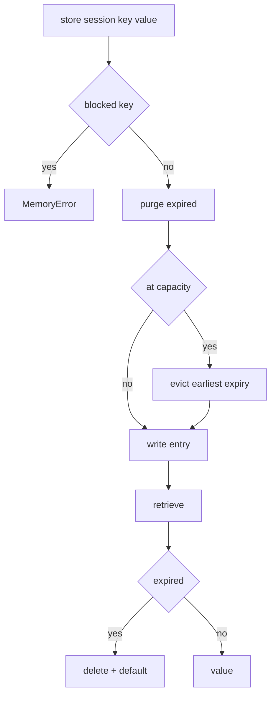

---
# MAM Metadata
id: template-example-memory
name: Session Memory Store
version: 2.0.0
type: memory

author: MAM Team

description: >
  A bounded, session-scoped memory store with per-entry TTL, a blocked-key list
  for secrets, deterministic eviction and an injectable clock so expiry can be
  tested without sleeping.

license: MIT

runtime:
  language: python
  version: ">=3.12"

tags:
  - template
  - example
  - memory
  - state

dependencies: []

capabilities:
  - store
  - retrieve
  - search
  - delete
  - list_keys

permissions:
  memory:
    - local
---

# Session Memory Store

## Purpose

Agents need short-term state that disappears. This module is a reference
implementation of that contract: entries are scoped to a session, carry their
own expiry, are capped so a runaway producer cannot exhaust memory, and are
blocked from holding credentials. The clock is injectable, so tests never sleep.

It stores JSON-compatible values only. It does not persist to disk, does not
share state between processes and does not encrypt anything; a caller that needs
durability or confidentiality should use a different memory backend behind the
same interface.

## Inputs

| Name | Type | Required | Description |
|------|------|----------|-------------|
| session | string | Yes | Session namespace, for example a conversation id |
| key | string | Yes | Entry name inside the session |
| value | any | Yes | JSON-compatible value to store |
| ttl_seconds | number | No | Entry lifetime, defaults to the store TTL |
| now | number | No | Clock override used by tests |

## Outputs

| Name | Type | Description |
|------|------|-------------|
| value | any | Stored value, or the supplied default when absent |
| found | boolean | Whether a live entry existed |
| expires_at | number | Unix timestamp when the entry is dropped |
| keys | array | Live keys in the session, sorted |
| matches | array | Entries whose string value contains the query |

## Capabilities

### store

Write a value with an expiry, evicting the entry that expires first when the
store is full.

### retrieve

Read a value and treat an expired entry as absent, removing it on the way out.

### search

Return live entries whose serialised value contains a case-insensitive query.

### delete

Remove one entry and report whether it existed.

### list_keys

Return the live keys of one session in sorted order so output is stable.

## Rules

- Keys containing `password`, `secret`, `token` or `api_key` are rejected.
- Every entry expires; there is no immortal entry.
- Expired entries are invisible to reads and are removed during purge.
- A full store evicts the entry with the earliest expiry, not a random entry.
- Sessions are isolated: one session can never read another's keys.
- Values must be JSON-compatible and are stored by value, not by reference.
- `ttl_seconds` must be positive; zero and negative values are rejected.

## Workflow



## Python

```python
import json
import time
from typing import Any, Callable, Dict, List, Optional

DEFAULT_TTL_SECONDS = 300
MAX_ENTRIES = 100
BLOCKED_FRAGMENTS = ("password", "secret", "token", "api_key")


class MemoryError(ValueError):
    """Raised when a memory operation violates the store contract."""


def _validate_name(value: Any, field: str) -> str:
    if not isinstance(value, str) or not value.strip():
        raise MemoryError(f"{field} must be a non-empty string")
    return value.strip()


class SessionMemory:
    """A bounded, session-scoped store with per-entry expiry."""

    def __init__(self, ttl_seconds: int = DEFAULT_TTL_SECONDS,
                 max_entries: int = MAX_ENTRIES,
                 clock: Optional[Callable[[], float]] = None) -> None:
        if ttl_seconds <= 0:
            raise MemoryError("ttl_seconds must be positive")
        if max_entries < 1:
            raise MemoryError("max_entries must be at least 1")
        self.ttl_seconds = ttl_seconds
        self.max_entries = max_entries
        self.clock = clock or time.time
        self._entries: Dict[str, Dict[str, Any]] = {}

    def _now(self, now: Optional[float]) -> float:
        return float(self.clock() if now is None else now)

    def _slot(self, session: str, key: str) -> str:
        return f"{session}\u0000{key}"

    def _purge(self, now: float) -> int:
        expired = [slot for slot, entry in self._entries.items() if entry["expires_at"] <= now]
        for slot in expired:
            del self._entries[slot]
        return len(expired)

    def store(self, session: str, key: str, value: Any,
              ttl_seconds: Optional[float] = None,
              now: Optional[float] = None) -> Dict[str, Any]:
        session = _validate_name(session, "session")
        key = _validate_name(key, "key")
        lowered = key.lower()
        if any(fragment in lowered for fragment in BLOCKED_FRAGMENTS):
            raise MemoryError(f"key '{key}' is reserved for secrets")
        ttl = self.ttl_seconds if ttl_seconds is None else float(ttl_seconds)
        if ttl <= 0:
            raise MemoryError("ttl_seconds must be positive")
        try:
            json.dumps(value)
        except (TypeError, ValueError) as exc:
            raise MemoryError("value must be JSON-compatible") from exc

        current = self._now(now)
        self._purge(current)
        while len(self._entries) >= self.max_entries:
            victim = min(self._entries, key=lambda slot: self._entries[slot]["expires_at"])
            del self._entries[victim]

        expires_at = current + ttl
        self._entries[self._slot(session, key)] = {
            "session": session,
            "key": key,
            "value": json.loads(json.dumps(value)),
            "expires_at": expires_at,
        }
        return {"key": key, "expires_at": expires_at}

    def retrieve(self, session: str, key: str, default: Any = None,
                 now: Optional[float] = None) -> Any:
        session = _validate_name(session, "session")
        key = _validate_name(key, "key")
        slot = self._slot(session, key)
        entry = self._entries.get(slot)
        if entry is None:
            return default
        if entry["expires_at"] <= self._now(now):
            del self._entries[slot]
            return default
        return entry["value"]

    def find(self, session: str, key: str, now: Optional[float] = None) -> Dict[str, Any]:
        session = _validate_name(session, "session")
        key = _validate_name(key, "key")
        value = self.retrieve(session, key, default=None, now=now)
        return {"value": value, "found": value is not None}

    def search(self, session: str, query: str, now: Optional[float] = None) -> List[Dict[str, Any]]:
        session = _validate_name(session, "session")
        if not isinstance(query, str):
            raise MemoryError("query must be a string")
        needle = query.lower()
        current = self._now(now)
        self._purge(current)
        matches = []
        for entry in self._entries.values():
            if entry["session"] != session:
                continue
            haystack = json.dumps(entry["value"], sort_keys=True).lower()
            if needle in haystack:
                matches.append({"key": entry["key"], "value": entry["value"]})
        return sorted(matches, key=lambda item: item["key"])

    def delete(self, session: str, key: str) -> bool:
        session = _validate_name(session, "session")
        key = _validate_name(key, "key")
        return self._entries.pop(self._slot(session, key), None) is not None

    def list_keys(self, session: str, now: Optional[float] = None) -> List[str]:
        session = _validate_name(session, "session")
        self._purge(self._now(now))
        return sorted(entry["key"] for entry in self._entries.values() if entry["session"] == session)


def run(session: str = "demo", now: Optional[float] = None) -> Dict[str, Any]:
    store = SessionMemory(ttl_seconds=60, max_entries=3)
    store.store(session, "topic", "billing", now=now)
    store.store(session, "turns", 2, now=now)
    return {
        "topic": store.retrieve(session, "topic", now=now),
        "keys": store.list_keys(session, now=now),
        "matches": store.search(session, "bill", now=now),
    }
```

## Tests

### Input

```yaml
session: chat-1
key: topic
value: billing
ttl_seconds: 60
```

### Expected

```yaml
value: billing
found: true
keys:
  - topic
```

```python
class FakeClock:
    def __init__(self, now: float) -> None:
        self.now = now

    def __call__(self) -> float:
        return self.now


def test_store_and_retrieve():
    store = SessionMemory()
    store.store("chat-1", "topic", "billing")
    assert store.retrieve("chat-1", "topic") == "billing"
    assert store.find("chat-1", "topic")["found"] is True


def test_expiry_hides_the_entry():
    clock = FakeClock(1000.0)
    store = SessionMemory(ttl_seconds=10, clock=clock)
    store.store("chat-1", "topic", "billing")
    clock.now = 1009.9
    assert store.retrieve("chat-1", "topic") == "billing"
    clock.now = 1010.0
    assert store.retrieve("chat-1", "topic", default="missing") == "missing"
    assert store.list_keys("chat-1") == []


def test_blocked_keys_are_refused():
    store = SessionMemory()
    for key in ("password", "api_key", "session_token", "client_secret"):
        try:
            store.store("chat-1", key, "x")
        except MemoryError:
            continue
        raise AssertionError(f"expected MemoryError for {key}")


def test_sessions_do_not_leak():
    store = SessionMemory()
    store.store("chat-1", "topic", "billing")
    assert store.retrieve("chat-2", "topic") is None
    store.store("chat-2", "topic", "shipping")
    assert store.retrieve("chat-1", "topic") == "billing"


def test_capacity_evicts_earliest_expiry():
    clock = FakeClock(0.0)
    store = SessionMemory(ttl_seconds=100, max_entries=2, clock=clock)
    store.store("s", "short", 1, ttl_seconds=10)
    store.store("s", "long", 2, ttl_seconds=90)
    store.store("s", "third", 3, ttl_seconds=50)
    assert store.retrieve("s", "short") is None
    assert store.list_keys("s") == ["long", "third"]


def test_delete_reports_whether_it_existed():
    store = SessionMemory()
    store.store("s", "k", 1)
    assert store.delete("s", "k") is True
    assert store.delete("s", "k") is False


def test_search_matches_values_only_in_session():
    store = SessionMemory()
    store.store("chat-1", "a", {"plan": "Billing Pro"})
    store.store("chat-1", "b", "shipping")
    store.store("chat-2", "c", "billing")
    matches = store.search("chat-1", "billing")
    assert [item["key"] for item in matches] == ["a"]


def test_values_are_stored_by_value():
    store = SessionMemory()
    payload = {"items": [1, 2]}
    store.store("s", "payload", payload)
    payload["items"].append(3)
    assert store.retrieve("s", "payload") == {"items": [1, 2]}


def test_invalid_arguments_are_rejected():
    store = SessionMemory()
    for session, key in (("", "k"), ("s", ""), ("   ", "k")):
        try:
            store.store(session, key, 1)
        except MemoryError:
            continue
        raise AssertionError(f"expected MemoryError for {session!r}/{key!r}")
    try:
        store.store("s", "k", 1, ttl_seconds=0)
    except MemoryError:
        pass
    else:
        raise AssertionError("expected MemoryError")
```

## Examples

```python
result = run("chat-1", now=1_700_000_000)
print(result["topic"])                       # billing
print(result["keys"])                        # ['topic', 'turns']
print(result["matches"])                     # [{'key': 'topic', 'value': 'billing'}]

store = SessionMemory(ttl_seconds=5)
store.store("chat-1", "step", {"name": "triage", "attempt": 1})
print(store.retrieve("chat-1", "step"))      # {'name': 'triage', 'attempt': 1}
print(store.list_keys("chat-1"))             # ['step']
print(store.delete("chat-1", "step"))        # True
```

## References

- [MAM Specification](../../../../plan-doc/full-mam.md)
- [Auth template](./auth.mam.md)
- [Planner template](./planner.mam.md)
