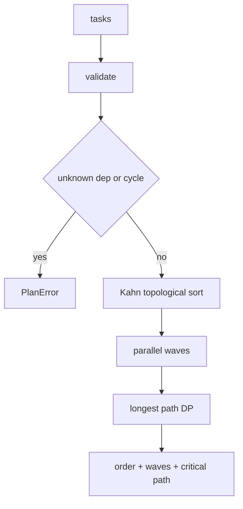

---
# MAM Metadata
id: template-example-planner
name: Dependency Planner
version: 2.0.0
type: module

author: MAM Team

description: >
  Deterministic planning for dependency graphs: validates task definitions,
  detects cycles and unknown dependencies, produces a stable topological order,
  groups independent work into parallel waves and computes the critical path.

license: MIT

runtime:
  language: python
  version: ">=3.12"

tags:
  - template
  - example
  - planner
  - graph

dependencies: []

capabilities:
  - validate
  - topological_sort
  - parallel_waves
  - critical_path

permissions:
  filesystem:
    - read
---

# Dependency Planner

## Purpose

Every scheduler eventually needs the same four answers: is this graph valid,
what order can I run it in, what can run at the same time, and what is the
longest path that sets the minimum duration. This module answers all four from
one task definition, deterministically.

It is a pure function over a dictionary of tasks. It does not execute anything,
does not persist state and does not consult a clock. The caller decides how to
run the waves; the planner only proves that the plan is sound.

## Inputs

| Name | Type | Required | Description |
|------|------|----------|-------------|
| tasks | object | Yes | Mapping of task name to `{duration, deps}` |
| duration | number | No | Per-task cost, defaults to 1 |
| deps | array | No | Names of tasks that must finish first |

## Outputs

| Name | Type | Description |
|------|------|-------------|
| order | array | Topological order, ties broken alphabetically |
| waves | array | Groups of tasks that may run concurrently |
| critical_path | array | Longest dependency chain by total duration |
| duration | number | Total duration of the critical path |
| parallel | boolean | True when at least one wave holds more than one task |

## Capabilities

### validate

Reject unknown dependencies, self-dependencies, duplicate edges, negative
durations and non-string task names before planning.

### topological_sort

Run Kahn's algorithm with a sorted ready set, so the same graph always produces
the same order regardless of insertion order.

### parallel_waves

Peel the graph one level at a time; every task whose dependencies are satisfied
in the same pass belongs to the same wave.

### critical_path

Dynamic programming over the topological order: each task finishes at the
maximum finish time of its dependencies plus its own duration.

## Rules

- Task names are non-empty strings and unique by construction of the mapping.
- A dependency must name a task in the same graph.
- A task may not depend on itself.
- Durations are finite, non-negative numbers.
- A cycle is an error, reported with the tasks that remain unresolved.
- Output order is deterministic: ties are always broken alphabetically.
- Planning is pure: no I/O, no clock, no mutation of the input.

## Workflow



## Python

```python
import math
from typing import Any, Dict, List, Optional, Sequence


class PlanError(ValueError):
    """Raised when a task graph cannot be planned."""


def _normalise(tasks: Dict[str, Any]) -> Dict[str, Dict[str, Any]]:
    if not isinstance(tasks, dict) or not tasks:
        raise PlanError("tasks must be a non-empty mapping")
    graph: Dict[str, Dict[str, Any]] = {}
    for name, raw in tasks.items():
        if not isinstance(name, str) or not name.strip():
            raise PlanError("task names must be non-empty strings")
        if raw is None:
            raw = {}
        if not isinstance(raw, dict):
            raise PlanError(f"task '{name}' must be an object")
        duration = raw.get("duration", 1)
        if not isinstance(duration, (int, float)) or isinstance(duration, bool):
            raise PlanError(f"task '{name}' duration must be a number")
        if not math.isfinite(duration) or duration < 0:
            raise PlanError(f"task '{name}' duration must be finite and >= 0")
        deps = raw.get("deps", [])
        if not isinstance(deps, (list, tuple)) or any(not isinstance(d, str) for d in deps):
            raise PlanError(f"task '{name}' deps must be a list of strings")
        if len(set(deps)) != len(deps):
            raise PlanError(f"task '{name}' has duplicate dependencies")
        graph[name] = {"duration": duration, "deps": list(deps)}
    for name, node in graph.items():
        for dep in node["deps"]:
            if dep == name:
                raise PlanError(f"task '{name}' cannot depend on itself")
            if dep not in graph:
                raise PlanError(f"task '{name}' depends on unknown task '{dep}'")
    return graph


def validate(tasks: Dict[str, Any]) -> None:
    """Raise PlanError when the graph is not plannable."""
    graph = _normalise(tasks)
    topological_sort(graph)


def topological_sort(tasks: Dict[str, Any]) -> List[str]:
    """Return a deterministic topological order."""
    graph = _normalise(tasks)
    indegree = {name: len(node["deps"]) for name, node in graph.items()}
    children: Dict[str, List[str]] = {name: [] for name in graph}
    for name, node in graph.items():
        for dep in node["deps"]:
            children[dep].append(name)

    ready = sorted(name for name, degree in indegree.items() if degree == 0)
    order: List[str] = []
    while ready:
        current = ready.pop(0)
        order.append(current)
        for child in sorted(children[current]):
            indegree[child] -= 1
            if indegree[child] == 0:
                ready.append(child)
        ready.sort()

    if len(order) != len(graph):
        unresolved = sorted(name for name, degree in indegree.items() if degree > 0)
        raise PlanError("cycle detected among: " + ", ".join(unresolved))
    return order


def parallel_waves(tasks: Dict[str, Any]) -> List[List[str]]:
    """Group tasks into waves whose dependencies are already satisfied."""
    graph = _normalise(tasks)
    remaining = {name: set(node["deps"]) for name, node in graph.items()}
    waves: List[List[str]] = []
    while remaining:
        wave = sorted(name for name, deps in remaining.items() if not deps)
        if not wave:
            raise PlanError("cycle detected: " + ", ".join(sorted(remaining)))
        waves.append(wave)
        for name in wave:
            del remaining[name]
        for deps in remaining.values():
            deps.difference_update(wave)
    return waves


def critical_path(tasks: Dict[str, Any]) -> Dict[str, Any]:
    """Return the longest dependency chain and its total duration."""
    graph = _normalise(tasks)
    order = topological_sort(graph)
    finish: Dict[str, float] = {}
    previous: Dict[str, Optional[str]] = {}
    for name in order:
        node = graph[name]
        if node["deps"]:
            parent = max(node["deps"], key=lambda dep: (finish[dep], dep))
            start = finish[parent]
        else:
            parent = None
            start = 0
        finish[name] = start + node["duration"]
        previous[name] = parent

    end = max(order, key=lambda name: (finish[name], name))
    path: List[str] = []
    cursor: Optional[str] = end
    while cursor is not None:
        path.append(cursor)
        cursor = previous[cursor]
    path.reverse()
    return {"path": path, "duration": finish[end]}


def plan(tasks: Dict[str, Any]) -> Dict[str, Any]:
    """Validate, order, wave and score a dependency graph."""
    graph = _normalise(tasks)
    waves = parallel_waves(graph)
    critical = critical_path(graph)
    return {
        "order": topological_sort(graph),
        "waves": waves,
        "critical_path": critical["path"],
        "duration": critical["duration"],
        "parallel": any(len(wave) > 1 for wave in waves),
    }


TASKS = {
    "fetch": {"duration": 2},
    "parse": {"duration": 3, "deps": ["fetch"]},
    "enrich": {"duration": 4, "deps": ["parse"]},
    "index": {"duration": 3, "deps": ["parse"]},
    "publish": {"duration": 2, "deps": ["enrich", "index"]},
}


def run(tasks: Optional[Dict[str, Any]] = None) -> Dict[str, Any]:
    """Plan the supplied graph, or the bundled reference graph."""
    return plan(TASKS if tasks is None else tasks)
```

## Tests

### Input

```yaml
tasks:
  build:
    duration: 2
  test:
    duration: 3
    deps: [build]
  lint:
    duration: 1
    deps: [build]
```

### Expected

```yaml
order: [build, lint, test]
waves:
  - [build]
  - [lint, test]
duration: 5
```

```python
def test_topological_order_is_deterministic():
    tasks = {
        "test": {"duration": 3, "deps": ["build"]},
        "lint": {"duration": 1, "deps": ["build"]},
        "build": {"duration": 2},
    }
    assert topological_sort(tasks) == ["build", "lint", "test"]
    assert topological_sort(dict(reversed(list(tasks.items())))) == ["build", "lint", "test"]


def test_parallel_waves_group_independent_work():
    tasks = {
        "build": {"duration": 2},
        "test": {"duration": 3, "deps": ["build"]},
        "lint": {"duration": 1, "deps": ["build"]},
    }
    assert parallel_waves(tasks) == [["build"], ["lint", "test"]]


def test_critical_path_picks_the_longest_chain():
    tasks = {
        "a": {"duration": 1},
        "b": {"duration": 5, "deps": ["a"]},
        "c": {"duration": 2, "deps": ["a"]},
        "d": {"duration": 1, "deps": ["b", "c"]},
    }
    result = critical_path(tasks)
    assert result["path"] == ["a", "b", "d"]
    assert result["duration"] == 7


def test_cycle_is_reported_with_members():
    tasks = {
        "a": {"deps": ["b"]},
        "b": {"deps": ["a"]},
    }
    try:
        topological_sort(tasks)
    except PlanError as exc:
        assert "a" in str(exc) and "b" in str(exc)
        return
    raise AssertionError("expected PlanError")


def test_unknown_dependency_is_rejected():
    try:
        plan({"a": {"deps": ["missing"]}})
    except PlanError as exc:
        assert "missing" in str(exc)
        return
    raise AssertionError("expected PlanError")


def test_self_dependency_is_rejected():
    try:
        plan({"a": {"deps": ["a"]}})
    except PlanError:
        return
    raise AssertionError("expected PlanError")


def test_negative_duration_is_rejected():
    try:
        plan({"a": {"duration": -1}})
    except PlanError:
        return
    raise AssertionError("expected PlanError")


def test_empty_graph_is_rejected():
    for bad in ({}, None, []):
        try:
            plan(bad)
        except PlanError:
            continue
        raise AssertionError(f"expected PlanError for {bad!r}")


def test_zero_duration_is_allowed():
    result = plan({"a": {"duration": 0}, "b": {"duration": 0, "deps": ["a"]}})
    assert result["order"] == ["a", "b"]
    assert result["duration"] == 0


def test_input_is_not_mutated():
    tasks = {"a": {"duration": 1}, "b": {"duration": 2, "deps": ["a"]}}
    before = {"a": {"duration": 1}, "b": {"duration": 2, "deps": ["a"]}}
    plan(tasks)
    assert tasks == before


def test_bundled_graph_has_parallel_branches():
    result = run()
    assert result["critical_path"] == ["fetch", "parse", "enrich", "publish"]
    assert result["duration"] == 11
    assert result["parallel"] is True
```

## Examples

```python
result = run()
print(result["order"])           # ['fetch', 'parse', 'enrich', 'index', 'publish']
print(result["waves"])           # [['fetch'], ['parse'], ['enrich', 'index'], ['publish']]
print(result["critical_path"])   # ['fetch', 'parse', 'enrich', 'publish']
print(result["duration"])        # 11

custom = plan({
    "download": {"duration": 3},
    "verify": {"duration": 1, "deps": ["download"]},
    "install": {"duration": 2, "deps": ["verify"]},
})
print(custom["waves"])           # [['download'], ['verify'], ['install']]
```

## References

- [MAM Specification](../../../../plan-doc/full-mam.md)
- [Auth template](./auth.mam.md)
- [Memory template](./memory.mam.md)
- [Kahn's algorithm](https://en.wikipedia.org/wiki/Topological_sorting)
