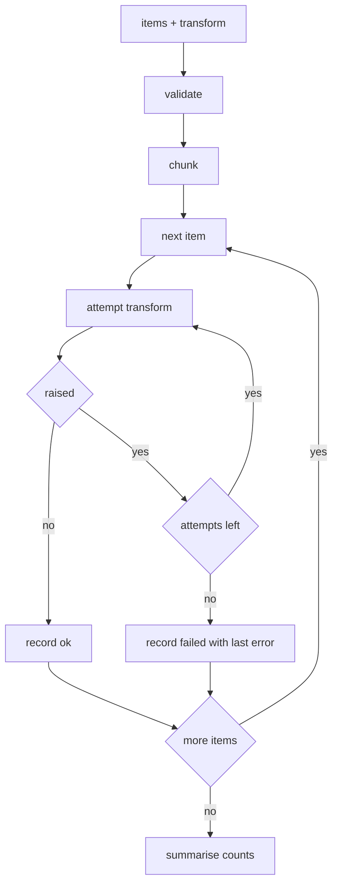

---
# MAM Metadata
id: template-advanced
name: Template Advanced
version: 2.0.0
type: module

author: Your Name

description: >
  A complete advanced starter: bounded batch processing with chunking,
  per-item retries, ordered results and an explicit success/failure report. Use
  it when the basic template is too small but a full agent is too much.

license: MIT

runtime:
  language: python
  version: ">=3.12"

tags:
  - template
  - module
  - advanced
  - reliability
  - batch

dependencies: []

capabilities:
  - chunk
  - process
  - report

permissions:
  filesystem:
    - read
  python:
    - sandbox
---

# Template Advanced

## Purpose

Batch jobs fail in the middle. This starter module shows the production shape:
split work into bounded chunks, attempt each item a fixed number of times,
preserve input order in the results and report exactly what succeeded and what
failed instead of raising on the first error.

It is pure: the caller supplies the transform, the module owns the control flow.
There are no placeholder branches — the shipped tests exercise retries, exhausted
retries and empty input.

## Inputs

| Name | Type | Required | Description |
|------|------|----------|-------------|
| items | array | Yes | Ordered items to process |
| transform | callable | Yes | Pure function applied to each item |
| chunk_size | integer | No | Items per chunk, defaults to 3 |
| retries | integer | No | Retries after the first attempt, defaults to 2 |

## Outputs

| Name | Type | Description |
|------|------|-------------|
| results | array | One `{item, status, attempts, value, error}` record per item |
| succeeded | integer | Items whose transform eventually returned |
| failed | integer | Items that exhausted their attempts |
| chunks | integer | Number of chunks the input was split into |
| attempts | integer | Total attempts across all items |

## Capabilities

### chunk

Split an ordered list into bounded chunks without dropping or duplicating an
item.

### process

Apply the transform to each item, retrying only failures, and keep the input
order in the output.

### report

Summarise the run as counts so a caller can alert on `failed > 0` without
scanning the records.

## Rules

- `items` must be a list; strings, generators and `None` are rejected.
- `transform` must be callable and is the only side-effecting component.
- `chunk_size` is between 1 and 100; `retries` is between 0 and 10.
- A retry happens only after an exception, never after a success.
- The last error is reported verbatim as `Type: message`, with no stack trace.
- Input order is preserved in `results`, regardless of retry counts.
- One failed item never aborts the remaining items.
- The input list is never mutated.

## Workflow



## Python

```python
from typing import Any, Callable, Dict, List

DEFAULT_CHUNK_SIZE = 3
DEFAULT_RETRIES = 2
MAX_CHUNK_SIZE = 100
MAX_RETRIES = 10


class BatchError(ValueError):
    """Raised when a batch cannot be processed as configured."""


def chunk(items: List[Any], size: int = DEFAULT_CHUNK_SIZE) -> List[List[Any]]:
    """Split items into consecutive chunks of at most `size`."""
    if not isinstance(items, list):
        raise BatchError("items must be a list")
    if not isinstance(size, int) or isinstance(size, bool):
        raise BatchError("chunk_size must be an integer")
    if not 1 <= size <= MAX_CHUNK_SIZE:
        raise BatchError(f"chunk_size must be between 1 and {MAX_CHUNK_SIZE}")
    return [items[index:index + size] for index in range(0, len(items), size)]


def process(items: List[Any], transform: Callable[[Any], Any],
            chunk_size: int = DEFAULT_CHUNK_SIZE,
            retries: int = DEFAULT_RETRIES) -> Dict[str, Any]:
    """Apply transform to every item with bounded retries."""
    if not isinstance(items, list):
        raise BatchError("items must be a list")
    if not callable(transform):
        raise BatchError("transform must be callable")
    if not isinstance(retries, int) or isinstance(retries, bool) or not 0 <= retries <= MAX_RETRIES:
        raise BatchError(f"retries must be between 0 and {MAX_RETRIES}")
    batches = chunk(items, chunk_size)

    results: List[Dict[str, Any]] = []
    total_attempts = 0
    for batch in batches:
        for item in batch:
            attempts = 0
            value: Any = None
            error = None
            while attempts <= retries:
                attempts += 1
                total_attempts += 1
                try:
                    value = transform(item)
                    error = None
                    break
                except Exception as exc:  # the transform is untrusted
                    error = f"{type(exc).__name__}: {exc}"
            results.append({
                "item": item,
                "status": "ok" if error is None else "failed",
                "attempts": attempts,
                "value": value if error is None else None,
                "error": error,
            })

    succeeded = sum(1 for record in results if record["status"] == "ok")
    return {
        "results": results,
        "succeeded": succeeded,
        "failed": len(results) - succeeded,
        "chunks": len(batches),
        "attempts": total_attempts,
    }


def run(items: List[int], retries: int = DEFAULT_RETRIES) -> Dict[str, Any]:
    """Process integers, failing negative values twice before giving up."""

    def double(value: int) -> int:
        if value < 0:
            raise ValueError("negative values are not accepted")
        return value * 2

    return process(items, double, retries=retries)
```

## Tests

### Input

```yaml
items: [1, -2, 3]
retries: 2
```

### Expected

```yaml
succeeded: 2
failed: 1
chunks: 1
attempts: 5
```

```python
def test_successful_batch_preserves_order():
    result = process([1, 2, 3, 4, 5], lambda value: value * 10)
    assert [record["value"] for record in result["results"]] == [10, 20, 30, 40, 50]
    assert result["succeeded"] == 5
    assert result["failed"] == 0
    assert result["chunks"] == 2


def test_chunk_splits_without_loss():
    assert chunk([1, 2, 3, 4, 5], 2) == [[1, 2], [3, 4], [5]]
    assert chunk([], 2) == []


def test_retry_recovers_a_transient_failure():
    calls = {"count": 0}

    def flaky(value):
        calls["count"] += 1
        if calls["count"] == 1:
            raise RuntimeError("temporary")
        return value * 2

    result = process([5], flaky, retries=1)
    assert result["results"][0]["status"] == "ok"
    assert result["results"][0]["attempts"] == 2
    assert result["results"][0]["value"] == 10


def test_exhausted_retries_are_reported():
    def always_fails(value):
        raise ValueError("nope")

    result = process([1, 2], always_fails, retries=2)
    assert result["succeeded"] == 0
    assert result["failed"] == 2
    assert result["attempts"] == 6
    assert result["results"][0]["error"] == "ValueError: nope"
    assert result["results"][0]["value"] is None


def test_one_failure_does_not_abort_the_batch():
    def sometimes(value):
        if value == 2:
            raise RuntimeError("bad")
        return value

    result = process([1, 2, 3], sometimes, retries=0)
    assert [record["status"] for record in result["results"]] == ["ok", "failed", "ok"]
    assert result["succeeded"] == 2


def test_empty_input_is_a_valid_batch():
    result = process([], lambda value: value)
    assert result == {"results": [], "succeeded": 0, "failed": 0, "chunks": 0, "attempts": 0}


def test_invalid_configuration_is_rejected():
    cases = [
        ("not-a-list", lambda value: value, 3, 2),
        ([1], None, 3, 2),
        ([1], lambda value: value, 0, 2),
        ([1], lambda value: value, 101, 2),
        ([1], lambda value: value, 3, -1),
        ([1], lambda value: value, 3, 11),
    ]
    for items, transform, size, retries in cases:
        try:
            process(items, transform, chunk_size=size, retries=retries)
        except BatchError:
            continue
        raise AssertionError(f"expected BatchError for {(items, transform, size, retries)!r}")


def test_input_list_is_not_mutated():
    items = [1, 2, 3]
    process(items, lambda value: value)
    assert items == [1, 2, 3]


def test_run_reports_failures_without_raising():
    result = run([1, -2, 3], retries=2)
    assert result["succeeded"] == 2
    assert result["failed"] == 1
    assert result["attempts"] == 5
```

## Examples

```python
result = run([1, -2, 3], retries=2)
print(result["succeeded"])  # 2
print(result["failed"])     # 1
print(result["attempts"])   # 5

calls = {"n": 0}

def flaky(value):
    calls["n"] += 1
    if calls["n"] == 1:
        raise TimeoutError("first attempt")
    return value.strip().upper()

report = process([" alpha ", " beta "], flaky, retries=1)
print([record["value"] for record in report["results"]])  # ['ALPHA', 'BETA']
print(report["chunks"])                                   # 1
```

## References

- [MAM Specification](../../../../plan-doc/full-mam.md)
- [Basic template](./basic.mam.md)
- [Workflow template](./workflow.mam.md)
