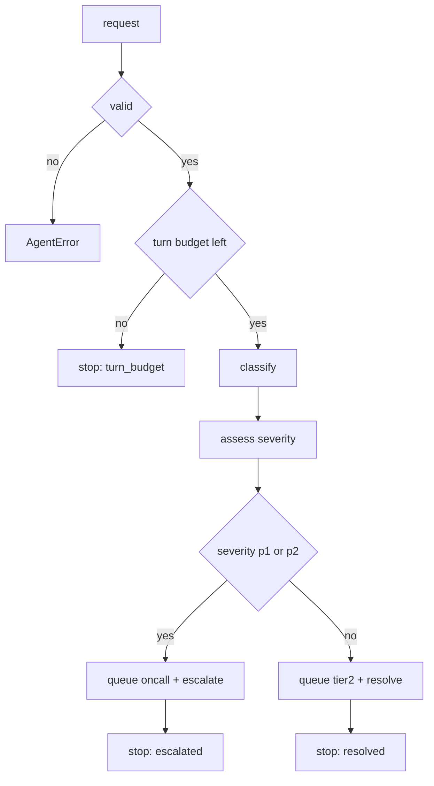

---
# MAM Metadata
id: template-agent
name: Template Agent
version: 2.0.0
type: agent
role: Escalation
goal: Route each request to the right queue and stop with a reason.

author: Your Name

description: >
  A complete agent starter: a role, a goal, an allow list of tools, a bounded
  turn budget and an explicit stop reason. It classifies an inbound request,
  assigns a severity and decides whether a human must take over.

license: MIT

runtime:
  language: python
  version: ">=3.12"

tags:
  - template
  - agent
  - triage

dependencies: []

capabilities:
  - classify
  - assess
  - decide

permissions:
  filesystem:
    - read
---

# Template Agent

## Purpose

A production agent is defined by its contract, not its prose. This starter has a
role (`Escalation`), a goal, two allowed tools (`classify`, `policy_lookup`), a
turn budget and three possible stop reasons (`escalated`, `resolved`,
`turn_budget`). It never calls a tool outside the allow list, never loops past
its budget and never returns without a stop reason.

Replace the category table and severity rules with your domain; keep the
contract, the budget and the stop reasons.

## Inputs

| Name | Type | Required | Description |
|------|------|----------|-------------|
| request | object | Yes | `{id, text}` inbound request |
| max_turns | integer | No | Maximum decisions per agent instance, defaults to 3 |

## Outputs

| Name | Type | Description |
|------|------|-------------|
| request_id | string | Id from the request |
| category | string | `security`, `billing`, `outage` or `other` |
| severity | string | `p1`, `p2` or `p3` |
| escalate | boolean | True when a human must take over |
| queue | string | `oncall` for p1/p2, `tier2` for p3 |
| tools | array | Tools the agent used, in order |
| stop_reason | string | `escalated`, `resolved` or `turn_budget` |

## Capabilities

### classify

Map the request text to one category using an ordered keyword table; ties break
by table order, never by chance.

### assess

Assign p1 for security or outage signals, p2 for urgency, p3 otherwise. Severity
is never lowered by a short request.

### decide

Turn category and severity into a queue, an escalation flag and a stop reason.

## Rules

- `request.id` and `request.text` are required and non-empty.
- Only tools on the allow list may run; anything else raises `AgentError`.
- Every decision ends with exactly one stop reason.
- `max_turns` is enforced by the agent, not by the caller.
- p1 and p2 always escalate to `oncall`; p3 goes to `tier2`.
- The agent never mutates the request and never retries.
- Decisions are deterministic: same request, same decision.

## Workflow



## Python

```python
from typing import Any, Dict, List, Optional, Sequence

ALLOWED_TOOLS = ("classify", "policy_lookup")
MAX_TURNS = 3
CATEGORIES = {
    "security": ("breach", "phishing", "password", "unauthorised", "unauthorized"),
    "outage": ("outage", "down", "data loss", "unavailable"),
    "billing": ("invoice", "charge", "refund", "payment"),
}
CRITICAL = ("breach", "data loss", "outage")
URGENT = ("urgent", "asap", "blocked", "cannot access", "production down")


class AgentError(ValueError):
    """Raised when a request or tool call violates the agent contract."""


def _text(request: Dict[str, Any]) -> str:
    if not isinstance(request, dict):
        raise AgentError("request must be an object")
    request_id = request.get("id")
    text = request.get("text")
    if not isinstance(request_id, str) or not request_id.strip():
        raise AgentError("request.id must be a non-empty string")
    if not isinstance(text, str) or not text.strip():
        raise AgentError("request.text must be a non-empty string")
    return text.lower()


class EscalationAgent:
    """Classify a request, score severity and decide who owns it."""

    role = "Escalation"
    goal = "Route each request to the right queue and stop with a reason."
    tools: Sequence[str] = ALLOWED_TOOLS

    def __init__(self, max_turns: int = MAX_TURNS,
                 tools: Optional[Sequence[str]] = None) -> None:
        if not isinstance(max_turns, int) or isinstance(max_turns, bool) or max_turns < 1:
            raise AgentError("max_turns must be an integer >= 1")
        self.max_turns = max_turns
        self.allowed_tools = tuple(tools if tools is not None else self.tools)
        self.turns = 0
        self.used: List[str] = []

    def call(self, tool: str) -> str:
        """Run a tool if the allow list admits it."""
        if tool not in self.allowed_tools:
            raise AgentError(f"tool '{tool}' is not allowed")
        self.used.append(tool)
        return tool

    def classify(self, text: str) -> str:
        best, best_hits = "other", 0
        for category, keywords in CATEGORIES.items():
            hits = sum(1 for keyword in keywords if keyword in text)
            if hits > best_hits:
                best, best_hits = category, hits
        return best

    def assess(self, category: str, text: str) -> str:
        if category in ("security", "outage") or any(word in text for word in CRITICAL):
            return "p1"
        if any(word in text for word in URGENT):
            return "p2"
        return "p3"

    def run(self, request: Dict[str, Any]) -> Dict[str, Any]:
        text = _text(request)
        if self.turns >= self.max_turns:
            return {
                "request_id": request["id"],
                "category": "other",
                "severity": "p3",
                "escalate": False,
                "queue": "tier2",
                "tools": list(self.used),
                "stop_reason": "turn_budget",
            }

        self.turns += 1
        self.call("classify")
        category = self.classify(text)
        severity = self.assess(category, text)
        escalate = severity in ("p1", "p2")
        return {
            "request_id": request["id"],
            "category": category,
            "severity": severity,
            "escalate": escalate,
            "queue": "oncall" if escalate else "tier2",
            "tools": list(self.used),
            "stop_reason": "escalated" if escalate else "resolved",
        }


def run(request: Dict[str, Any], max_turns: int = MAX_TURNS) -> Dict[str, Any]:
    return EscalationAgent(max_turns=max_turns).run(request)
```

## Tests

### Input

```yaml
request:
  id: REQ-1
  text: "We see a data loss incident in production"
```

### Expected

```yaml
category: outage
severity: p1
escalate: true
queue: oncall
stop_reason: escalated
```

```python
def test_critical_request_escalates():
    result = run({"id": "REQ-1", "text": "data loss in production"})
    assert result["category"] == "outage"
    assert result["severity"] == "p1"
    assert result["queue"] == "oncall"
    assert result["stop_reason"] == "escalated"
    assert result["tools"] == ["classify"]


def test_routine_billing_request_resolves():
    result = run({"id": "REQ-2", "text": "question about my invoice"})
    assert result["category"] == "billing"
    assert result["severity"] == "p3"
    assert result["escalate"] is False
    assert result["queue"] == "tier2"
    assert result["stop_reason"] == "resolved"


def test_urgent_signal_escalates_to_p2():
    result = run({"id": "REQ-3", "text": "locked out and blocked, urgent"})
    assert result["severity"] == "p2"
    assert result["escalate"] is True


def test_security_wins_over_billing_keywords():
    result = run({"id": "REQ-4", "text": "password breach after a refund"})
    assert result["category"] == "security"
    assert result["severity"] == "p1"


def test_unmatched_request_falls_back_to_other():
    result = run({"id": "REQ-5", "text": "just saying hello"})
    assert result["category"] == "other"
    assert result["severity"] == "p3"
    assert result["stop_reason"] == "resolved"


def test_turn_budget_stops_the_agent():
    agent = EscalationAgent(max_turns=1)
    first = agent.run({"id": "REQ-6", "text": "outage"})
    second = agent.run({"id": "REQ-6", "text": "outage"})
    assert first["stop_reason"] == "escalated"
    assert second["stop_reason"] == "turn_budget"


def test_unlisted_tool_is_refused():
    agent = EscalationAgent(tools=["classify"])
    try:
        agent.call("shell")
    except AgentError:
        return
    raise AssertionError("expected AgentError")


def test_invalid_request_is_rejected():
    for bad in ({}, {"id": ""}, {"id": "x"}, {"id": "x", "text": "  "}, None):
        try:
            run(bad)
        except AgentError:
            continue
        raise AssertionError(f"expected AgentError for {bad!r}")


def test_decisions_are_deterministic():
    request = {"id": "REQ-7", "text": "invoice refund"}
    assert run(request) == run(request)
```

## Examples

```python
result = run({"id": "REQ-1", "text": "data loss in production"})
print(result["category"], result["severity"], result["stop_reason"])
# outage p1 escalated

routine = run({"id": "REQ-2", "text": "question about my invoice"})
print(routine["queue"], routine["escalate"])
# tier2 False

agent = EscalationAgent(max_turns=1)
print(agent.run({"id": "REQ-3", "text": "urgent outage"})["stop_reason"])
print(agent.run({"id": "REQ-3", "text": "urgent outage"})["stop_reason"])
# escalated
# turn_budget
```

## References

- [MAM Specification](../../../../plan-doc/full-mam.md)
- [Workflow template](./workflow.mam.md)
- [Service template](./service.mam.md)
