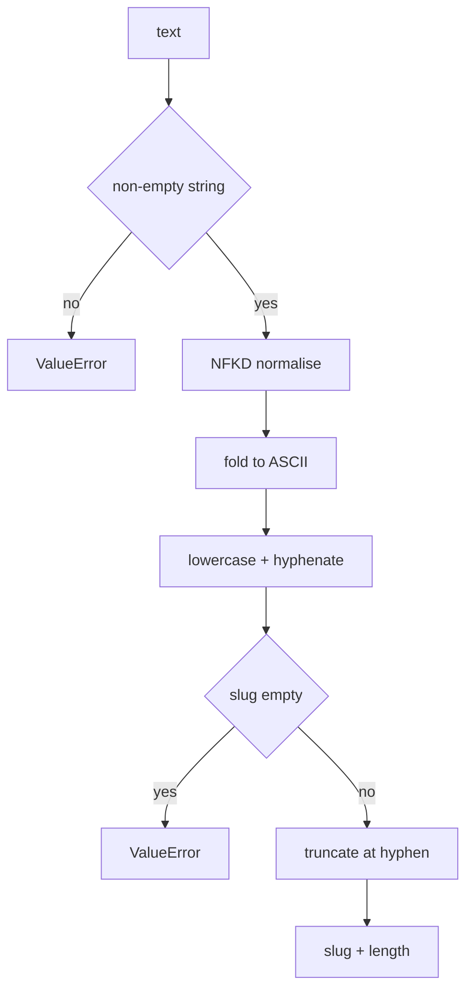

---
# MAM Metadata
id: template-basic
name: Template Basic
version: 2.0.0
type: module

author: Your Name

description: >
  A complete starter module: turn arbitrary text into a stable, URL-safe slug.
  Ships with real Python, executable tests and a runnable example, so a new
  module passes validation and execution on the first run.

license: MIT

runtime:
  language: python
  version: ">=3.12"

tags:
  - template
  - module
  - starter

dependencies: []

capabilities:
  - normalise
  - slugify

permissions:
  filesystem:
    - read
---

# Template Basic

## Purpose

A starter module you can rename and replace. It converts text into a slug:
Unicode is normalised, accents are folded to ASCII, runs of non-alphanumeric
characters collapse to a single hyphen, and the result is trimmed to a stable
maximum length. There are no placeholders to fill in — the module validates,
runs and passes its tests as shipped.

## Inputs

| Name | Type | Required | Description |
|------|------|----------|-------------|
| text | string | Yes | Text to convert into a slug |
| prefix | string | No | Namespace prepended to the slug |
| max_length | integer | No | Maximum slug length, defaults to 64 |

## Outputs

| Name | Type | Description |
|------|------|-------------|
| slug | string | Lowercase, hyphen-separated, ASCII-only identifier |
| length | integer | Length of the slug after truncation |
| input | string | Original text, echoed for traceability |

## Capabilities

### normalise

Fold Unicode to ASCII, lowercase, replace non-alphanumeric runs with one hyphen
and trim leading and trailing hyphens.

### slugify

Combine an optional prefix and the normalised text, then truncate at a hyphen
boundary so the result never ends mid-word.

## Rules

- Input must be a non-empty string; anything else raises `ValueError`.
- Text that normalises to an empty slug raises `ValueError`.
- Slugs contain only `a-z`, `0-9` and `-`.
- No leading or trailing hyphens, and no double hyphens.
- Truncation never leaves a trailing hyphen.
- `max_length` must be between 8 and 200.
- The function is pure: the same input always returns the same slug.

## Workflow



## Python

```python
import re
import unicodedata
from typing import Any, Dict

DEFAULT_MAX_LENGTH = 64
MIN_MAX_LENGTH = 8
MAX_MAX_LENGTH = 200


def _validate(value: Any, field: str) -> str:
    if not isinstance(value, str) or not value.strip():
        raise ValueError(f"{field} must be a non-empty string")
    return value.strip()


def normalise(text: str, max_length: int = DEFAULT_MAX_LENGTH) -> str:
    """Return a lowercase ASCII slug for arbitrary text."""
    text = _validate(text, "text")
    if not isinstance(max_length, int) or isinstance(max_length, bool):
        raise ValueError("max_length must be an integer")
    if not MIN_MAX_LENGTH <= max_length <= MAX_MAX_LENGTH:
        raise ValueError(f"max_length must be between {MIN_MAX_LENGTH} and {MAX_MAX_LENGTH}")
    folded = unicodedata.normalize("NFKD", text).encode("ascii", "ignore").decode("ascii")
    slug = re.sub(r"[^a-z0-9]+", "-", folded.lower()).strip("-")
    if not slug:
        raise ValueError("text must contain at least one letter or digit")
    if len(slug) > max_length:
        slug = slug[:max_length].rstrip("-")
    return slug


def slugify(text: str, prefix: str = "", max_length: int = DEFAULT_MAX_LENGTH) -> str:
    """Return a prefixed slug, truncated at a word boundary."""
    slug = normalise(text, max_length=max_length)
    if prefix:
        slug = f"{normalise(prefix, max_length=max_length)}-{slug}"
    if len(slug) > max_length:
        slug = slug[:max_length].rstrip("-")
    return slug


def run(text: str, prefix: str = "", max_length: int = DEFAULT_MAX_LENGTH) -> Dict[str, Any]:
    """Convert text into a slug and report its length."""
    slug = slugify(text, prefix=prefix, max_length=max_length)
    return {"input": text, "slug": slug, "length": len(slug)}
```

## Tests

### Input

```yaml
text: Café déjà vu!
prefix: docs
```

### Expected

```yaml
slug: docs-cafe-deja-vu
length: 16
```

```python
def test_folds_accents_and_punctuation():
    assert normalise("Café déjà vu!") == "cafe-deja-vu"


def test_collapses_runs_of_separators():
    assert normalise("  hello___world -- again  ") == "hello-world-again"


def test_prefix_is_normalised_too():
    result = run("Café déjà vu!", prefix="Docs")
    assert result["slug"] == "docs-cafe-deja-vu"
    assert result["length"] == len("docs-cafe-deja-vu")


def test_truncation_never_leaves_a_trailing_hyphen():
    slug = normalise("alpha beta gamma delta epsilon zeta eta theta", max_length=20)
    assert len(slug) <= 20
    assert not slug.endswith("-")


def test_max_length_is_enforced():
    slug = normalise("word " * 100, max_length=32)
    assert len(slug) == 32
    assert slug == slug.strip("-")


def test_invalid_text_is_rejected():
    for bad in ("", "   ", None, 42):
        try:
            normalise(bad)
        except ValueError:
            continue
        raise AssertionError(f"expected ValueError for {bad!r}")


def test_text_without_ascii_is_rejected():
    try:
        normalise("日本語")
    except ValueError:
        return
    raise AssertionError("expected ValueError")


def test_invalid_max_length_is_rejected():
    for bad in (0, 7, 201, True, "64"):
        try:
            normalise("hello world", max_length=bad)
        except ValueError:
            continue
        raise AssertionError(f"expected ValueError for {bad!r}")


def test_output_is_deterministic():
    assert run("Same Input") == run("Same Input")
```

## Examples

```python
result = run("Café déjà vu!", prefix="docs")
print(result["slug"])    # docs-cafe-deja-vu
print(result["length"])  # 16

for raw in ("Hello, World!", "  MAM  modules  ", "100% ready"):
    print(raw, "->", slugify(raw))

print(normalise("Release 2.0 \u2014 Final", max_length=12))  # release-2-0
```

## References

- [MAM Specification](../../../../plan-doc/full-mam.md)
- [MAM examples](../../../../modules/examples/)
- [Agent template](./agent.mam.md)
