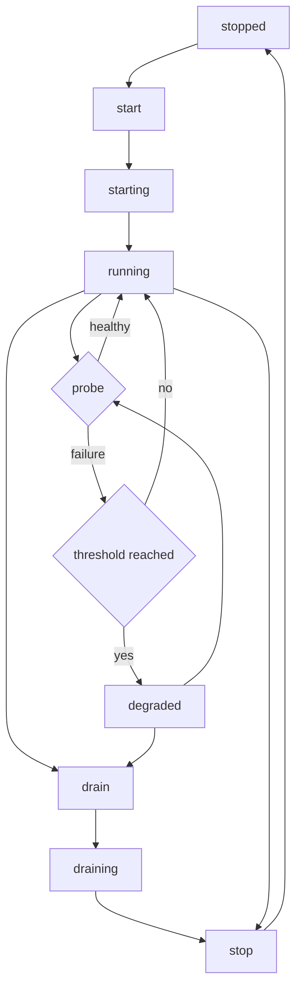

---
# MAM Metadata
id: template-service
name: Template Service
version: 2.0.0
type: service

author: Your Name

description: >
  A complete service starter: an explicit lifecycle, health checks with a
  failure threshold, a degraded state, graceful draining and a snapshot that a
  supervisor can poll without reading internal fields.

license: MIT

runtime:
  language: python
  version: ">=3.12"

tags:
  - template
  - service
  - lifecycle
  - health

dependencies: []

capabilities:
  - start
  - check
  - drain
  - stop

permissions:
  filesystem:
    - read
---

# Template Service

## Purpose

A service that cannot explain its own state is impossible to operate. This
starter makes the lifecycle explicit — `stopped`, `starting`, `running`,
`degraded`, `draining` — and only allows the transitions that make sense. Health
checks update the state; three consecutive failures mark the service degraded; a
recovery returns it to running; draining stops accepting checks; stopping is
idempotent.

The service performs no I/O. The supervisor supplies health signals, which keeps
the state machine testable and the behaviour deterministic.

## Inputs

| Name | Type | Required | Description |
|------|------|----------|-------------|
| name | string | Yes | Service name, used in snapshots |
| healthy | boolean | Yes | Result of one health probe |
| failure_threshold | integer | No | Consecutive failures before degraded, defaults to 3 |

## Outputs

| Name | Type | Description |
|------|------|-------------|
| state | string | Current lifecycle state |
| ready | boolean | True only while `running` |
| checks | integer | Total health probes received |
| failures | integer | Total failed probes |
| consecutive_failures | integer | Failures since the last healthy probe |
| history | array | State transitions in order |

## Capabilities

### start

Move `stopped → starting → running` and record both transitions.

### check

Accept a health signal while running or degraded, update counters and move to
`degraded` after the threshold.

### drain

Move to `draining` so the supervisor stops sending probes before shutdown.

### stop

Move any live state to `stopped`; stopping an already stopped service succeeds.

## Rules

- Only declared transitions are allowed; anything else raises `ServiceError`.
- Health checks are rejected before `start` and after `drain`.
- `failure_threshold` is between 1 and 100.
- A healthy probe resets `consecutive_failures` and returns the state to running.
- `ready` is true only in the running state, never in degraded or draining.
- `stop` is idempotent: stopping a stopped service is a no-op success.
- Snapshots are copies; callers cannot mutate service state through them.

## Workflow



## Python

```python
from typing import Any, Dict, List, Optional

STATES = ("stopped", "starting", "running", "degraded", "draining")
DEFAULT_FAILURE_THRESHOLD = 3
MAX_FAILURE_THRESHOLD = 100


class ServiceError(ValueError):
    """Raised when a lifecycle transition or probe is not allowed."""


class HealthCheckService:
    """A service whose lifecycle and health are explicit."""

    def __init__(self, name: str, failure_threshold: int = DEFAULT_FAILURE_THRESHOLD) -> None:
        if not isinstance(name, str) or not name.strip():
            raise ServiceError("name must be a non-empty string")
        if not isinstance(failure_threshold, int) or isinstance(failure_threshold, bool):
            raise ServiceError("failure_threshold must be an integer")
        if not 1 <= failure_threshold <= MAX_FAILURE_THRESHOLD:
            raise ServiceError(f"failure_threshold must be between 1 and {MAX_FAILURE_THRESHOLD}")
        self.name = name.strip()
        self.failure_threshold = failure_threshold
        self.state = "stopped"
        self.checks = 0
        self.failures = 0
        self.consecutive_failures = 0
        self.history: List[str] = ["stopped"]

    def _move(self, target: str, allowed: tuple) -> None:
        if self.state not in allowed:
            raise ServiceError(f"cannot move from '{self.state}' to '{target}'")
        self.state = target
        self.history.append(target)

    def start(self) -> Dict[str, Any]:
        self._move("starting", ("stopped",))
        self._move("running", ("starting",))
        return self.snapshot()

    def check(self, healthy: bool) -> Dict[str, Any]:
        if not isinstance(healthy, bool):
            raise ServiceError("healthy must be a boolean")
        if self.state not in ("running", "degraded"):
            raise ServiceError(f"cannot check while '{self.state}'")
        self.checks += 1
        if healthy:
            self.consecutive_failures = 0
            if self.state == "degraded":
                self._move("running", ("degraded",))
        else:
            self.failures += 1
            self.consecutive_failures += 1
            if self.state == "running" and self.consecutive_failures >= self.failure_threshold:
                self._move("degraded", ("running",))
        return self.snapshot()

    def drain(self) -> Dict[str, Any]:
        self._move("draining", ("running", "degraded"))
        return self.snapshot()

    def stop(self) -> Dict[str, Any]:
        if self.state == "stopped":
            return self.snapshot()
        self._move("stopped", ("starting", "running", "degraded", "draining"))
        return self.snapshot()

    def ready(self) -> bool:
        return self.state == "running"

    def snapshot(self) -> Dict[str, Any]:
        return {
            "name": self.name,
            "state": self.state,
            "ready": self.ready(),
            "checks": self.checks,
            "failures": self.failures,
            "consecutive_failures": self.consecutive_failures,
            "history": list(self.history),
        }


def run(probes: List[bool], failure_threshold: int = DEFAULT_FAILURE_THRESHOLD) -> Dict[str, Any]:
    """Start a service, apply the probes, then drain and stop it."""
    service = HealthCheckService("template-service", failure_threshold=failure_threshold)
    service.start()
    for healthy in probes:
        service.check(healthy)
    service.drain()
    return service.stop()
```

## Tests

### Input

```yaml
probes: [true, false, false, false]
failure_threshold: 3
```

### Expected

```yaml
state: stopped
ready: false
checks: 4
failures: 3
history: [stopped, starting, running, degraded, draining, stopped]
```

```python
def test_start_reaches_running_and_is_ready():
    service = HealthCheckService("api")
    snapshot = service.start()
    assert snapshot["state"] == "running"
    assert snapshot["ready"] is True
    assert snapshot["history"] == ["stopped", "starting", "running"]


def test_three_failures_mark_degraded():
    service = HealthCheckService("api", failure_threshold=3)
    service.start()
    service.check(False)
    service.check(False)
    assert service.state == "running"
    snapshot = service.check(False)
    assert snapshot["state"] == "degraded"
    assert snapshot["ready"] is False
    assert snapshot["failures"] == 3


def test_healthy_probe_recovers_from_degraded():
    service = HealthCheckService("api", failure_threshold=2)
    service.start()
    service.check(False)
    service.check(False)
    assert service.state == "degraded"
    snapshot = service.check(True)
    assert snapshot["state"] == "running"
    assert snapshot["consecutive_failures"] == 0
    assert snapshot["ready"] is True


def test_checks_are_rejected_before_start_and_after_drain():
    service = HealthCheckService("api")
    try:
        service.check(True)
    except ServiceError:
        pass
    else:
        raise AssertionError("expected ServiceError before start")

    service.start()
    service.drain()
    try:
        service.check(True)
    except ServiceError:
        return
    raise AssertionError("expected ServiceError after drain")


def test_drain_and_stop_are_recorded():
    service = HealthCheckService("api")
    service.start()
    service.drain()
    snapshot = service.stop()
    assert snapshot["state"] == "stopped"
    assert snapshot["history"] == ["stopped", "starting", "running", "draining", "stopped"]


def test_stop_is_idempotent():
    service = HealthCheckService("api")
    first = service.stop()
    second = service.stop()
    assert first == second
    assert second["history"] == ["stopped"]


def test_cannot_start_twice():
    service = HealthCheckService("api")
    service.start()
    try:
        service.start()
    except ServiceError:
        return
    raise AssertionError("expected ServiceError")


def test_invalid_configuration_and_probes_are_rejected():
    for threshold in (0, 101, True, "3"):
        try:
            HealthCheckService("api", failure_threshold=threshold)
        except ServiceError:
            continue
        raise AssertionError(f"expected ServiceError for {threshold!r}")

    service = HealthCheckService("api")
    service.start()
    try:
        service.check("yes")
    except ServiceError:
        return
    raise AssertionError("expected ServiceError")


def test_snapshot_is_a_copy():
    service = HealthCheckService("api")
    service.start()
    snapshot = service.snapshot()
    snapshot["history"].append("tampered")
    snapshot["state"] = "degraded"
    assert service.state == "running"
    assert "tampered" not in service.history


def test_run_applies_the_whole_lifecycle():
    result = run([True, False, False, False], failure_threshold=3)
    assert result["state"] == "stopped"
    assert result["checks"] == 4
    assert result["failures"] == 3
    assert result["history"] == ["stopped", "starting", "running", "degraded", "draining", "stopped"]
```

## Examples

```python
result = run([True, False, False, False], failure_threshold=3)
print(result["state"])    # stopped
print(result["checks"])   # 4
print(result["failures"]) # 3
print(result["history"])  # ['stopped', 'starting', 'running', 'degraded', 'draining', 'stopped']

service = HealthCheckService("worker", failure_threshold=2)
service.start()
print(service.ready())    # True
service.check(False)
service.check(False)
print(service.state)      # degraded
service.check(True)
print(service.state)      # running
print(service.drain()["state"])  # draining
```

## References

- [MAM Specification](../../../../plan-doc/full-mam.md)
- [Agent template](./agent.mam.md)
- [Basic template](./basic.mam.md)
