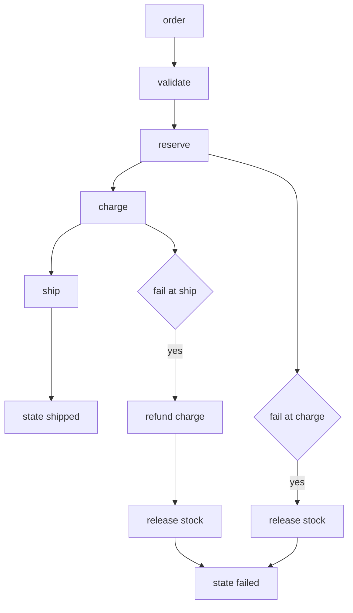

---
# MAM Metadata
id: template-workflow
name: Template Workflow
version: 2.0.0
type: workflow

author: Your Name

description: >
  A complete workflow starter: an order fulfilment pipeline with ordered steps,
  explicit state transitions, reverse-order compensation when a step fails and a
  deterministic idempotency key.

license: MIT

runtime:
  language: python
  version: ">=3.12"

tags:
  - template
  - workflow
  - pipeline
  - saga

dependencies: []

capabilities:
  - validate
  - execute
  - compensate

permissions:
  filesystem:
    - read
---

# Template Workflow

## Purpose

A workflow is a sequence with consequences. This starter models an order
fulfilment saga: reserve stock, charge the customer, ship the parcel. If any step
fails, the steps that already ran are compensated in reverse order, and the
result records exactly what happened.

It is deterministic and side-effect free: the actions are modelled as state
transitions and ledger entries, so the workflow can be exercised in tests without
a payment provider or a warehouse.

## Inputs

| Name | Type | Required | Description |
|------|------|----------|-------------|
| order | object | Yes | `{id, items: [{sku, quantity}]}` |
| fail_at | string | No | Force a failure at `reserve`, `charge` or `ship` |

## Outputs

| Name | Type | Description |
|------|------|-------------|
| order_id | string | Order identifier from the input |
| state | string | `shipped` on success, `failed` after compensation |
| completed | array | Steps that ran, in order |
| compensations | array | Reverse-order undo actions that ran |
| ledger | array | Append-only record of every transition |
| idempotency_key | string | Stable key derived from the order |

## Capabilities

### validate

Reject orders without an id, with no items, or with a quantity below one before
any step runs.

### execute

Run `reserve`, `charge` and `ship` in order, recording each transition in the
ledger and advancing the state.

### compensate

On failure, undo completed steps in reverse order and record each compensation
in the ledger.

## Rules

- Steps always run in the declared order; no step is skipped on the happy path.
- Compensation runs in reverse order of completion, and only for completed steps.
- The workflow never partially compensates: every completed step is undone.
- `fail_at` must be a known step when supplied.
- An order needs an id and at least one item with a positive integer quantity.
- The idempotency key is derived from the order content, never from a clock.
- The input order is never mutated.

## Workflow



## Python

```python
from typing import Any, Dict, List, Optional

STEPS = (
    ("reserve", "reserved", "release stock"),
    ("charge", "charged", "refund charge"),
    ("ship", "shipped", "recall shipment"),
)
STEP_NAMES = tuple(step[0] for step in STEPS)


class WorkflowError(ValueError):
    """Raised when an order or workflow configuration is invalid."""


def validate_order(order: Dict[str, Any]) -> None:
    if not isinstance(order, dict):
        raise WorkflowError("order must be an object")
    order_id = order.get("id")
    if not isinstance(order_id, str) or not order_id.strip():
        raise WorkflowError("order.id must be a non-empty string")
    items = order.get("items")
    if not isinstance(items, list) or not items:
        raise WorkflowError("order.items must be a non-empty list")
    for item in items:
        if not isinstance(item, dict):
            raise WorkflowError("each item must be an object")
        sku = item.get("sku")
        quantity = item.get("quantity")
        if not isinstance(sku, str) or not sku.strip():
            raise WorkflowError("item.sku must be a non-empty string")
        if not isinstance(quantity, int) or isinstance(quantity, bool) or quantity < 1:
            raise WorkflowError("item.quantity must be an integer >= 1")


def idempotency_key(order: Dict[str, Any]) -> str:
    parts = [order["id"]]
    for item in order["items"]:
        parts.append(f"{item['sku'].strip()}x{item['quantity']}")
    return "|".join(parts)


def run(order: Dict[str, Any], fail_at: Optional[str] = None) -> Dict[str, Any]:
    """Execute the fulfilment saga, compensating on failure."""
    if fail_at is not None and fail_at not in STEP_NAMES:
        raise WorkflowError(f"fail_at must be one of {', '.join(STEP_NAMES)}")
    validate_order(order)

    state = "pending"
    completed: List[str] = []
    compensations: List[str] = []
    ledger: List[str] = []

    for name, next_state, undo in STEPS:
        if fail_at == name:
            ledger.append(f"{name}: failed")
            for done in reversed(completed):
                undo_action = next(step[2] for step in STEPS if step[0] == done)
                compensations.append(undo_action)
                ledger.append(f"compensate {done}: {undo_action}")
            state = "failed"
            return {
                "order_id": order["id"],
                "state": state,
                "completed": completed,
                "compensations": compensations,
                "ledger": ledger,
                "idempotency_key": idempotency_key(order),
            }

        completed.append(name)
        state = next_state
        ledger.append(f"{name}: {next_state}")

    return {
        "order_id": order["id"],
        "state": state,
        "completed": completed,
        "compensations": compensations,
        "ledger": ledger,
        "idempotency_key": idempotency_key(order),
    }
```

## Tests

### Input

```yaml
order:
  id: order-1001
  items:
    - sku: sku-red
      quantity: 2
fail_at: charge
```

### Expected

```yaml
state: failed
completed: [reserve]
compensations: [release stock]
```

```python
ORDER = {"id": "order-1001", "items": [{"sku": "sku-red", "quantity": 2}]}


def test_happy_path_reaches_shipped():
    result = run(ORDER)
    assert result["state"] == "shipped"
    assert result["completed"] == ["reserve", "charge", "ship"]
    assert result["compensations"] == []
    assert result["ledger"] == ["reserve: reserved", "charge: charged", "ship: shipped"]


def test_failure_compensates_in_reverse_order():
    result = run(ORDER, fail_at="ship")
    assert result["state"] == "failed"
    assert result["completed"] == ["reserve", "charge"]
    assert result["compensations"] == ["refund charge", "release stock"]


def test_failure_at_first_step_compensates_nothing():
    result = run(ORDER, fail_at="reserve")
    assert result["state"] == "failed"
    assert result["completed"] == []
    assert result["compensations"] == []
    assert result["ledger"] == ["reserve: failed"]


def test_ledger_records_compensations():
    result = run(ORDER, fail_at="charge")
    assert result["ledger"] == [
        "reserve: reserved",
        "charge: failed",
        "compensate reserve: release stock",
    ]


def test_idempotency_key_is_stable_and_content_based():
    first = run(ORDER)
    second = run(dict(ORDER))
    assert first["idempotency_key"] == second["idempotency_key"] == "order-1001|sku-redx2"


def test_invalid_fail_at_is_rejected():
    try:
        run(ORDER, fail_at="deliver")
    except WorkflowError:
        return
    raise AssertionError("expected WorkflowError")


def test_invalid_orders_are_rejected():
    bad_orders = [
        {},
        {"id": "", "items": [{"sku": "a", "quantity": 1}]},
        {"id": "o", "items": []},
        {"id": "o", "items": [{"sku": "", "quantity": 1}]},
        {"id": "o", "items": [{"sku": "a", "quantity": 0}]},
        {"id": "o", "items": [{"sku": "a", "quantity": 1.5}]},
    ]
    for bad in bad_orders:
        try:
            run(bad)
        except WorkflowError:
            continue
        raise AssertionError(f"expected WorkflowError for {bad!r}")


def test_input_order_is_not_mutated():
    snapshot = {"id": "order-1", "items": [{"sku": "sku-a", "quantity": 1}]}
    before = {"id": "order-1", "items": [{"sku": "sku-a", "quantity": 1}]}
    run(snapshot)
    assert snapshot == before
```

## Examples

```python
order = {"id": "order-1001", "items": [{"sku": "sku-red", "quantity": 2}]}

ok = run(order)
print(ok["state"])            # shipped
print(ok["ledger"])           # ['reserve: reserved', 'charge: charged', 'ship: shipped']

failed = run(order, fail_at="ship")
print(failed["state"])            # failed
print(failed["compensations"])    # ['refund charge', 'release stock']
print(failed["idempotency_key"])  # order-1001|sku-redx2

result = run(order)
print(result["state"])
```

## References

- [MAM Specification](../../../../plan-doc/full-mam.md)
- [Advanced template](./advanced.mam.md)
- [Agent template](./agent.mam.md)
