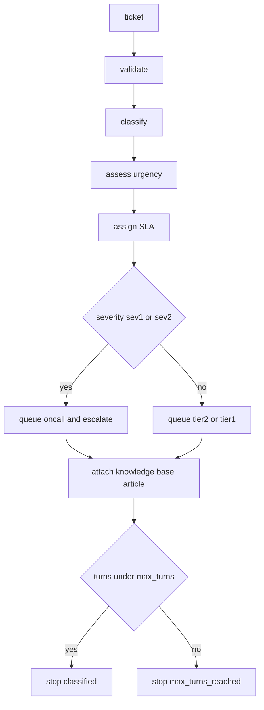

---
# MAM Metadata
id: example-agent
name: Support Triage Agent
version: 2.0.0
type: agent
role: Support Triage
goal: Turn an inbound ticket into a routing decision and stop with a reason.
tools:
  - knowledge_base_search
  - customer_context
  - create_ticket_note

author: MAM Team

description: >
  An autonomous support agent that reads one inbound ticket, classifies it,
  scores its urgency against an SLA table, decides whether a human must
  intervene and stops with an explicit stop reason. Demonstrates the `agent`
  type: a role, a goal, a bounded tool set and a termination policy.

license: MIT

runtime:
  language: python
  version: ">=3.12"

tags:
  - example
  - agent
  - support
  - triage

dependencies: []

capabilities:
  - classify
  - assess_urgency
  - plan
  - explain

permissions:
  filesystem:
    - read
---

# Support Triage Agent

## Purpose

A concrete `agent`: the front desk of a SaaS support queue. It takes one inbound
ticket, works out what kind of problem it is, how urgent it is, and where it
should go, then stops. The agent is deliberately deterministic — no model calls,
no network — because the interesting part of an agent is not its intelligence
but its contract: what it is allowed to do, and the conditions under which it
declares itself finished.

The agent may call three tools: a knowledge base search, a customer context
lookup and a ticket note writer. It never deletes a ticket, never contacts the
customer and never changes account state.

## Inputs

| Name | Type | Required | Description |
|------|------|----------|-------------|
| ticket | object | Yes | Inbound ticket with `id`, `subject` and `body` |
| knowledge_base | object | No | Mapping of category to article title |
| max_turns | number | No | Maximum reasoning turns, defaults to 6 |
| now | string | No | ISO-8601 timestamp used for SLA deadlines |

## Outputs

| Name | Type | Description |
|------|------|-------------|
| category | string | billing, technical, account, feature-request or other |
| severity | string | sev1, sev2, sev3 or sev4 |
| queue | string | oncall, tier2 or tier1 |
| escalate | boolean | True when a human must look at the ticket |
| suggested_article | string | Knowledge base article, empty when none matched |
| sla_minutes | integer | First-response target for the severity |
| confidence | number | 0.0–1.0 score for the classification |
| reasons | list | Human-readable reasons for each decision |
| stop_reason | string | classified or max_turns_reached |

## Agent Identity

The Support Triage Agent is the first responder for every inbound support
ticket. It is not a chatbot and it does not resolve issues: it reads, classifies,
prioritises and routes. Every decision it makes is explainable from the ticket
text alone, and every reason it produces can be quoted to a human reviewer.

The agent owns exactly one turn of work per ticket. It never follows up, never
waits for more information and never asks the customer a question. If the ticket
is ambiguous the agent routes it to a human instead of guessing.

## Role Description

This agent is the authority on ticket classification, severity scoring and queue
selection. It collaborates with tier-1 agents that resolve routine billing and
account questions, tier-2 engineers who own technical investigations, and the
on-call rotation that handles incidents. It does not write fixes, does not
contact customers and does not modify account state — it produces a routing
decision and a short justification for the next owner.

## Profile

| Attribute | Value |
|-----------|-------|
| Agent ID | `example-agent` |
| Category | `support` |
| Specialization | Ticket classification and routing |
| Primary tools | `knowledge_base_search`, `customer_context`, `create_ticket_note` |
| Memory | none (stateless per ticket) |
| Handoff targets | Tier 1, Tier 2, On-call |
| Termination | One decision per ticket, or `max_turns` reached |
| Latency budget | Under 50 ms, no network calls |
| Failure mode | Route to a human, never drop a ticket |

## Capabilities

### classify

Map a ticket to exactly one support category using an ordered keyword table.
Ties are broken by table order so the result is reproducible.

### assess_urgency

Score a ticket on the sev1–sev4 scale from its category plus critical and
urgent signals in the subject and body.

### plan

Turn a category and a severity into a queue, an escalation flag, an SLA target
and a suggested knowledge base article.

### explain

Render the decision as a short, quotable explanation for the next owner.

## Core Competencies

### 1. Ticket classification

Assign exactly one category from `billing`, `technical`, `account`,
`feature-request` and `other`. Count keyword hits per category and take the
highest; ties resolve by table order, never by randomness or model sampling.

### 2. Severity scoring

Start from the category baseline (billing/technical/account = sev3,
feature-request/other = sev4), raise critical signals to sev1, and raise
urgent signals by one level. Never lower a severity because a ticket is short.

### 3. Escalation policy

`sev1` and `sev2` always escalate and route to on-call. `sev3` routes to tier 2
without escalation. `sev4` routes to tier 1 without escalation.

### 4. SLA assignment

Attach a first-response target per severity: sev1 15 minutes, sev2 60 minutes,
sev3 8 hours, sev4 3 business days.

### 5. Knowledge base grounding

Suggest an article only when the category has a mapping in the supplied
knowledge base. Never invent an article name, never link an article from another
category.

### 6. Termination discipline

Return exactly one decision per ticket. If the turn budget is exhausted, stop
with `max_turns_reached` instead of looping.

### 7. Explainability

Emit a `reasons` list whose entries can be quoted verbatim to a customer or an
engineer: which keywords matched, which signals fired, which queue was chosen.

### 8. Input validation

Reject tickets without an `id`, `subject` or `body` with a `ValueError`. A
malformed ticket is a caller bug, not something to classify.

### 9. Determinism

Identical tickets must produce identical decisions. No clocks, no randomness,
no environment reads inside the decision path.

### 10. Least privilege

The agent may read the knowledge base and customer context; it may write one
ticket note. It never deletes, reassigns or closes a ticket.

### 11. Handoff quality

The handoff carries the category, severity, queue, SLA and reasons, so the next
owner never has to re-read the ticket to understand why it arrived.

### 12. Failure containment

When anything is ambiguous — no keywords, unknown category, empty knowledge
base — fall back to `other`/sev4/tier1 rather than failing the request.

## Response Format Template

```json
{
  "category": "billing",
  "severity": "sev3",
  "queue": "tier2",
  "escalate": false,
  "suggested_article": "Refunds and duplicate charges",
  "sla_minutes": 480,
  "confidence": 0.4,
  "reasons": [
    "matched billing keywords: invoice, refund",
    "category baseline severity sev3",
    "no critical or urgent signals"
  ],
  "stop_reason": "classified"
}
```

Every decision must be renderable as this object; missing fields are a contract
violation.

## Decision-Making Framework

### Severity matrix

| Signal | Effect |
|--------|--------|
| outage, data loss, breach | force sev1 |
| cannot access, blocked, urgent, asap, production down | raise one level |
| no signal | category baseline |

### Routing matrix

| Severity | Queue | Escalate | First response |
|----------|-------|----------|----------------|
| sev1 | oncall | yes | 15 minutes |
| sev2 | oncall | yes | 60 minutes |
| sev3 | tier2 | no | 8 hours |
| sev4 | tier1 | no | 3 business days |

### Confidence

Confidence is `matched_categories / total_categories_considered` for the winning
category, capped at 1.0. A ticket with no keyword hits reports `0.0` and is
still routed (to `other`), because dropping it is worse than a conservative
route.

## Communication Style

- **With customers:** never. This agent produces internal routing only.
- **With tier 1:** one line per ticket — category, severity, article, reason.
- **With engineers:** include the matched keywords so the classification can be
  audited without re-reading the whole ticket.
- **With other agents:** structural handoff (queue + severity + reasons), not
  prose.

## Tool Access and Capabilities

| Tool | Purpose | Side effects | Permission |
|------|---------|--------------|------------|
| `knowledge_base_search` | Look up an article by category | none | read |
| `customer_context` | Read plan tier and account state | none | read |
| `create_ticket_note` | Attach the routing decision | one note | write (scoped) |

The agent has no access to billing mutations, refunds, deletion or customer
email.

## Integration Patterns with Other Agents

- **Tier 1 resolver** receives sev4 tickets and may close them without escalation.
- **Tier 2 engineer agent** receives sev3 tickets with the suggested article.
- **On-call agent** receives sev1/sev2 tickets with reasons and SLA deadline.
- **Escalation agent** is invoked only when the on-call queue is saturated; the
  triage agent never calls it directly.

## Rules

- The agent must never write to the ticket store; it may only produce a plan.
- Exactly one category is assigned per ticket, chosen by highest keyword hit
  count with ties broken by table order.
- A ticket containing an outage, data loss or breach signal is sev1.
- A sev1 or sev2 ticket always escalates and routes to the oncall queue.
- The agent must stop after `max_turns` turns and report `max_turns_reached`.
- The agent must never invent an article; `suggested_article` is empty when no
  keyword matches the knowledge base.
- A ticket without `id`, `subject` or `body` is rejected with `ValueError`.
- Decisions must be deterministic and free of network calls.

## Workflow



## Python

```python
from typing import Any, Dict, List, Optional

CATEGORY_KEYWORDS: Dict[str, tuple] = {
    "billing": ("invoice", "charge", "charged", "refund", "payment", "subscription"),
    "technical": ("error", "crash", "500", "timeout", "bug", "broken", "stack trace",
                  "outage", "down", "slow", "latency"),
    "account": ("login", "password", "mfa", "2fa", "sso", "locked out", "access"),
    "feature-request": ("feature request", "please add", "would be nice", "roadmap"),
}

BASE_SEVERITY = {
    "billing": "sev3",
    "technical": "sev3",
    "account": "sev3",
    "feature-request": "sev4",
    "other": "sev4",
}

SEVERITY_ORDER = ["sev1", "sev2", "sev3", "sev4"]

CRITICAL_SIGNALS = ("outage", "data loss", "data lost", "breach")
URGENT_SIGNALS = ("cannot access", "blocked", "urgent", "asap", "production down")

QUEUE_BY_SEVERITY = {"sev1": "oncall", "sev2": "oncall", "sev3": "tier2", "sev4": "tier1"}

SLA_MINUTES = {"sev1": 15, "sev2": 60, "sev3": 480, "sev4": 4320}

ESCALATING_SEVERITIES = ("sev1", "sev2")


class TicketError(ValueError):
    """Raised when a ticket does not satisfy the agent input contract."""


def validate_ticket(ticket: Dict[str, Any]) -> None:
    """Reject tickets that cannot be triaged."""
    if not isinstance(ticket, dict):
        raise TicketError("ticket must be an object")
    for field in ("id", "subject", "body"):
        value = ticket.get(field)
        if not isinstance(value, str) or not value.strip():
            raise TicketError(f"ticket.{field} must be a non-empty string")


class SupportTriageAgent:
    """Classify, score and route inbound support tickets."""

    role = "Support Triage"
    goal = "Turn an inbound ticket into a routing decision and stop with a reason."
    tools = ("knowledge_base_search", "customer_context", "create_ticket_note")
    max_turns = 6

    def __init__(self, knowledge_base: Optional[Dict[str, str]] = None,
                 max_turns: Optional[int] = None) -> None:
        self.knowledge_base = dict(knowledge_base or {})
        if max_turns is not None:
            if max_turns < 1:
                raise ValueError("max_turns must be at least 1")
            self.max_turns = max_turns
        self.turns = 0
        self.trace: List[str] = []

    @staticmethod
    def _text(ticket: Dict[str, Any]) -> str:
        return f"{ticket.get('subject', '')} {ticket.get('body', '')}".lower()

    def classify(self, ticket: Dict[str, Any]) -> Dict[str, Any]:
        text = self._text(ticket)
        best, best_hits, matched = "other", 0, []
        for category, keywords in CATEGORY_KEYWORDS.items():
            hits = [keyword for keyword in keywords if keyword in text]
            if len(hits) > best_hits:
                best, best_hits, matched = category, len(hits), hits
        return {
            "category": best,
            "hits": matched,
            "confidence": round(min(1.0, best_hits / len(CATEGORY_KEYWORDS)), 2),
        }

    def assess_urgency(self, ticket: Dict[str, Any], category: str) -> Dict[str, Any]:
        text = self._text(ticket)
        critical = [signal for signal in CRITICAL_SIGNALS if signal in text]
        if critical:
            return {"severity": "sev1", "reasons": [f"critical signal: {critical[0]}"]}
        urgent = [signal for signal in URGENT_SIGNALS if signal in text]
        index = SEVERITY_ORDER.index(BASE_SEVERITY[category])
        if urgent:
            index = max(0, index - 1)
        reason = f"urgent signal: {urgent[0]}" if urgent else "category baseline"
        return {"severity": SEVERITY_ORDER[index], "reasons": [reason]}

    def plan(self, ticket: Dict[str, Any]) -> Dict[str, Any]:
        validate_ticket(ticket)
        classification = self.classify(ticket)
        urgency = self.assess_urgency(ticket, classification["category"])
        severity = urgency["severity"]
        return {
            "category": classification["category"],
            "severity": severity,
            "queue": QUEUE_BY_SEVERITY[severity],
            "escalate": severity in ESCALATING_SEVERITIES,
            "suggested_article": self.knowledge_base.get(classification["category"], ""),
            "sla_minutes": SLA_MINUTES[severity],
            "confidence": classification["confidence"],
            "reasons": (
                ([f"matched {classification['category']} keywords: {', '.join(classification['hits'])}"]
                 if classification["hits"] else ["no category keywords matched"])
                + urgency["reasons"]
            ),
        }

    def run(self, ticket: Dict[str, Any]) -> Dict[str, Any]:
        self.turns += 1
        decision = self.plan(ticket)
        decision["stop_reason"] = "classified" if self.turns < self.max_turns else "max_turns_reached"
        self.trace.append(f"turn {self.turns}: {decision['category']}/{decision['severity']}")
        return decision


def run(ticket: Dict[str, Any], knowledge_base: Optional[Dict[str, str]] = None) -> Dict[str, Any]:
    return SupportTriageAgent(knowledge_base).run(ticket)


def explain(ticket: Dict[str, Any], knowledge_base: Optional[Dict[str, str]] = None) -> str:
    decision = run(ticket, knowledge_base)
    reasons = "; ".join(decision["reasons"])
    return (
        f"{ticket.get('id', '?')}: {decision['category']} {decision['severity']} "
        f"-> {decision['queue']} (SLA {decision['sla_minutes']}m) because {reasons}"
    )
```

## Tests

### Input

```yaml
ticket:
  id: T-1042
  subject: "Charged twice for September"
  body: "I was charged twice for the same invoice and need a refund."
```

### Expected

```yaml
category: billing
severity: sev3
queue: tier2
escalate: false
sla_minutes: 480
```

```python
def test_classifies_billing_ticket():
    decision = run({"id": "T-1", "subject": "Charged twice", "body": "I need a refund on the invoice."})
    assert decision["category"] == "billing"
    assert decision["queue"] == "tier2"
    assert decision["escalate"] is False
    assert decision["sla_minutes"] == 480


def test_outage_escalates_to_oncall():
    decision = run({"id": "T-2", "subject": "API outage", "body": "We have a full outage, data loss possible."})
    assert decision["severity"] == "sev1"
    assert decision["queue"] == "oncall"
    assert decision["escalate"] is True
    assert decision["sla_minutes"] == 15


def test_urgent_signal_raises_one_level():
    decision = run({"id": "T-3", "subject": "Locked out", "body": "I cannot access my account, this is urgent."})
    assert decision["category"] == "account"
    assert decision["severity"] == "sev2"
    assert decision["escalate"] is True


def test_untitled_ticket_falls_back_to_other():
    decision = run({"id": "T-4", "subject": "hello", "body": "just saying hi"})
    assert decision["category"] == "other"
    assert decision["severity"] == "sev4"
    assert decision["queue"] == "tier1"
    assert decision["suggested_article"] == ""
    assert decision["confidence"] == 0.0


def test_agent_stops_at_max_turns():
    agent = SupportTriageAgent(max_turns=1)
    ticket = {"id": "T-5", "subject": "crash", "body": "the app crashes with a stack trace"}
    assert agent.run(ticket)["stop_reason"] == "max_turns_reached"
    assert agent.run(ticket)["stop_reason"] == "max_turns_reached"


def test_agent_rejects_invalid_tickets():
    for bad in ({}, {"id": "x"}, {"id": "x", "subject": "s"}, {"id": "x", "subject": "s", "body": "  "}):
        try:
            run(bad)
        except TicketError:
            continue
        raise AssertionError(f"expected TicketError for {bad!r}")


def test_knowledge_base_article_is_attached():
    kb = {"billing": "Refunds and duplicate charges"}
    decision = run({"id": "T-6", "subject": "charged", "body": "duplicate charge"}, kb)
    assert decision["suggested_article"] == "Refunds and duplicate charges"


def test_reasons_are_quotable():
    decision = run({"id": "T-7", "subject": "API outage", "body": "production down"})
    assert any("critical signal" in reason for reason in decision["reasons"])
    assert any("outage" in reason for reason in decision["reasons"])


def test_decisions_are_deterministic():
    ticket = {"id": "T-8", "subject": "Bug in billing", "body": "charge failed with an error"}
    assert run(ticket) == run(ticket)


def test_explain_renders_one_line():
    line = explain({"id": "T-9", "subject": "refund", "body": "I need a refund"})
    assert line.startswith("T-9: billing")
    assert "because" in line
```

## Examples

```python
KNOWLEDGE_BASE = {
    "billing": "Refunds and duplicate charges",
    "account": "Recovering a locked account",
    "technical": "Investigating production incidents",
}

tickets = [
    {"id": "T-1", "subject": "Charged twice", "body": "please refund the invoice"},
    {"id": "T-2", "subject": "API outage", "body": "total outage, production down"},
    {"id": "T-3", "subject": "Feature request", "body": "please add a dark mode"},
]

for ticket in tickets:
    print(ticket["id"], run(ticket, KNOWLEDGE_BASE))

print(explain(tickets[1], KNOWLEDGE_BASE))

result = run(tickets[1], KNOWLEDGE_BASE)
print(result["stop_reason"])
```

## Best Practices

- Keep the keyword table ordered and reviewed; every new keyword needs a test.
- Treat `reasons` as part of the public contract — humans read them.
- Route ambiguity to a human; never invent confidence you do not have.
- Keep the agent stateless across tickets; state belongs to the ticket store.
- Measure the share of `other` decisions; a rising rate means the keyword table
  is drifting from real tickets.

## Common Anti-Patterns

- **Model-in-the-loop for classification.** Sampling makes routing
  non-deterministic and unauditable.
- **Lowering severity to hit an SLA.** SLA targets follow severity, never the
  reverse.
- **Guessing an article.** A wrong article costs the customer more time than no
  article.
- **Looping for more context.** This agent has one turn; more context is a human
  job.
- **Writing to the ticket store.** Routing is a proposal, not a mutation.

## Performance Optimization Patterns

- Pre-lowercase the ticket text once per decision.
- Keep keyword tables as tuples so iteration order is stable.
- Avoid regex in the hot path; substring checks handle millions of tickets.
- Cache the knowledge base per process, not per ticket.
- Benchmark with a fixed ticket corpus; the target is under 50 ms per decision.

## Security Considerations

- Treat ticket text as untrusted input: never `eval`, never shell out.
- Do not log full ticket bodies; log the decision and redacted reasons.
- The agent reads customer context but must not persist it.
- `create_ticket_note` is scoped to one note; it cannot edit existing notes.
- Reject malformed tickets rather than coercing them.

## Troubleshooting Guide

| Symptom | Likely cause | Action |
|---------|--------------|--------|
| Everything is `other` | keyword table drift | review recent tickets, add keywords with tests |
| Too many sev1 | critical signals too broad | tighten the critical list, keep data loss |
| Escalation storms | urgent signals in marketing copy | require signal in subject or first 200 chars |
| Missing article | knowledge base key mismatch | align keys with categories |
| `TicketError` in production | caller sends partial tickets | validate at the ingress boundary |

## Quick Reference Card

- One ticket in, one decision out.
- sev1/sev2 → oncall + escalate; sev3 → tier2; sev4 → tier1.
- SLA: 15m / 60m / 8h / 3d.
- No article → empty string, never a guess.
- Reasons must be quotable.
- Stop reason is always present.

## References

- [MAM Specification](../../../plan-doc/full-mam.md)
- [Agent templates](../../../templates/agent/)
- [API Gateway example](../../advanced/modules/api-gateway.mam)
- [Support triage runbook in the reference agents](https://github.com/tcp-ecosystem/awesome-mam)
