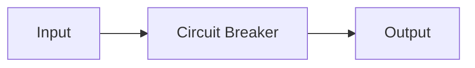

---
# MAM Metadata
id: examples-component
name: Component System
version: 2.0.0
type: system

author: MAM Team

description: >
  Composes the component example modules into a runnable system: a composition
  root, a project manifest, and canonical .mam/.mam.md pairs under modules/.

license: MIT

runtime:
  language: python
  version: ">=3.12"

tags:
  - example
  - system
  - component

dependencies:
  - name: example-component
    version: ">=2.0.0"

capabilities:
  - call
  - record_success
  - record_failure
  - state_of

permissions:
  filesystem:
    - read
---

# Component System

## Purpose

Entry system for the `component` example. It composes **Circuit Breaker** and keeps the folder shape
identical to every other example: a composing `system.mam`, a project `mam.toml`, and canonical `.mam`/`.mam.md` pairs under `modules/`.

## Inputs

| Name | Type | Required | Description |
|------|------|----------|-------------|
| mode | string | No | `demo` runs the composition; `validate` checks the wiring |
| payload | object | No | Optional input forwarded to the first module |

## Outputs

| Name | Type | Description |
|------|------|-------------|
| status | string | `ok` when the composition is wired |
| modules | list | Composed module ids in dependency order |
| capabilities | list | Union of the composed modules' capabilities |

## Modules

- **Circuit Breaker** (`example-component`) — A `component` is a part of a bigger system that other code is allowed to depend on: it has a contract, a stat…

## Capabilities

### `call`

Delegates to **Circuit Breaker**.

### `record_success`

Delegates to **Circuit Breaker**.

### `record_failure`

Delegates to **Circuit Breaker**.

### `state_of`

Delegates to **Circuit Breaker**.

## Rules

- The breaker starts closed and forwards every call.
- `failure_threshold` consecutive failures open the breaker and set the cooldown
- While open every call is short-circuited and the dependency is never invoked.
- Once the cooldown has elapsed the first call moves the breaker to half-open
- `success_threshold` consecutive half-open successes close the breaker and
- Any failure in half-open reopens the breaker immediately.

## Workflow



## Python

```python
MODULES = ["example-component"]
CAPABILITIES = ["call", "record_success", "record_failure", "state_of"]
EDGES = []


def run_system(mode="demo", payload=None):
    """Validate the composition and report what the system wires together."""
    if mode not in ("demo", "validate"):
        raise ValueError(f"unknown mode: {mode}")
    if len(set(MODULES)) != len(MODULES):
        return {"status": "error", "reason": "duplicate modules", "modules": MODULES}
    known = set(MODULES)
    dangling = [edge for edge in EDGES if edge[0] not in known or edge[1] not in known]
    if dangling:
        return {"status": "error", "reason": "dangling edge", "modules": MODULES}
    return {
        "status": "ok",
        "mode": mode,
        "modules": MODULES,
        "capabilities": CAPABILITIES,
        "edges": EDGES,
        "payload": payload,
    }
```

## Tests

### Input

```yaml
mode: demo
```

### Expected

```yaml
status: ok
```

```python
def test_system_composition():
    result = run_system("demo")
    assert result["status"] == "ok"
    assert result["modules"] == MODULES
    assert result["capabilities"] == CAPABILITIES
    assert result["edges"] == EDGES


def test_system_rejects_unknown_mode():
    try:
        run_system("deploy")
    except ValueError:
        return
    raise AssertionError("unknown mode must be rejected")
```

## Examples

```python
result = run_system("demo", {"target": "example.com"})
print(result["status"], len(result["modules"]))
```

## References

- [component README](./README.md)
- [Examples index](../README.md)
- [MAM specification](../../../plan-doc/full-mam.md)
