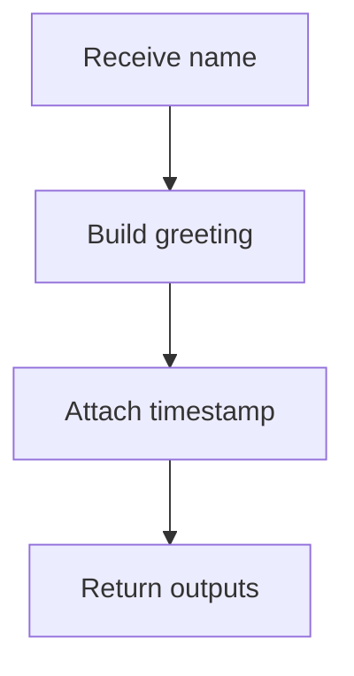

---
# MAM Metadata
id: hello
name: Hello
version: 2.0.0
type: module

author: LifeJiggy

description: >
  Minimal standalone MAM module: returns a greeting and an ISO-8601 timestamp.
  Useful as the first module to run and as a template for new folders.

license: MIT

runtime:
  language: python
  version: ">=3.12"

tags:
  - example
  - starter

dependencies: []

capabilities:
  - greet

permissions:
  filesystem:
    - read
---

# Hello

## Purpose

Return a greeting for a given name. This module is a standalone `.mam`
artifact executed natively by the MAM runtime, without compiling to Python,
JavaScript, or any other target.

## Inputs

| Name | Type | Required | Description |
|------|------|----------|-------------|
| name | string | No | Name to greet (defaults to "World") |

## Outputs

| Name | Type | Description |
|------|------|-------------|
| greeting | string | The generated greeting message |
| timestamp | string | ISO-8601 timestamp of execution |

## Capabilities

### greet

Build a greeting for the supplied name.

## Rules

- Always return a greeting message.
- Include a timestamp with every response.
- Never expose internal errors to the caller.
- An empty or missing name falls back to "World".

## Workflow



## Python

```python
from datetime import datetime, timezone


def greet(name: str = "World") -> dict:
    """Return a greeting and an ISO-8601 timestamp."""
    clean = (name or "").strip() or "World"
    return {
        "greeting": f"Hello, {clean}!",
        "timestamp": datetime.now(timezone.utc).isoformat(),
    }
```

## Tests

### Input

```yaml
name: World
```

### Expected

```yaml
greeting: Hello, World!
timestamp: present
```

```python
def test_greet_default() -> None:
    result = greet()
    assert result["greeting"] == "Hello, World!"
    assert result["timestamp"]


def test_greet_custom() -> None:
    assert greet("MAM")["greeting"] == "Hello, MAM!"
```

## Examples

```python
result = greet("MAM")
print(result["greeting"])
```

## References

- MAM documentation
- plan-doc/full-mam.md
