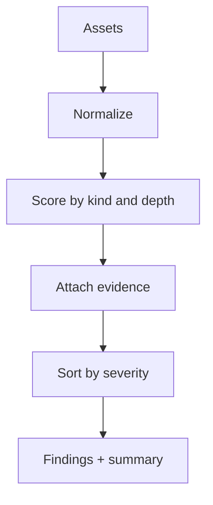

---
# MAM Metadata
id: analyzer
name: Analyzer
version: 2.0.0
type: module

author: MAM Team

description: >
  Consumes discovered assets and produces findings ranked by severity, with
  evidence attached to every finding.

license: MIT

runtime:
  language: python
  version: ">=3.12"

tags:
  - security
  - analysis

dependencies:
  - name: recon
    version: ">=2.0.0"

capabilities:
  - analyze

permissions:
  filesystem:
    - read
---

# Analyzer

## Purpose

Consumes discovered assets and produces findings ranked by severity. Every
finding carries the asset it came from, a stable kind and the evidence that
justified the severity, so the report stage never invents detail.

## Inputs

| Name | Type | Required | Description |
|------|------|----------|-------------|
| assets | list | Yes | Assets from the recon stage |
| rules | dict | No | Override severity for specific asset kinds |

## Outputs

| Name | Type | Description |
|------|------|-------------|
| findings | list | Ranked findings: `{asset, kind, severity, evidence}` |
| summary | object | Counts per severity |

## Capabilities

### analyze

Assess assets and produce ranked findings.

## Rules

- Preserve evidence for every finding.
- Validate results before reporting.
- Never raise severity without a matching evidence entry.
- Findings for out-of-scope assets are dropped, not downgraded.

## Workflow



## Python

```python
from typing import Any, Dict, List

SEVERITY_ORDER = ["critical", "high", "medium", "low", "info"]
DEFAULT_SEVERITY = {"host": "medium", "subdomain": "low"}


def analyze(assets: List[Dict[str, Any]], rules: Dict[str, str] | None = None) -> Dict[str, Any]:
    """Assess assets and return ranked findings with evidence."""
    overrides = {**DEFAULT_SEVERITY, **(rules or {})}
    findings: List[Dict[str, Any]] = []

    for asset in assets:
        name = str(asset.get("asset") or "").strip().lower()
        if not name:
            continue
        kind = str(asset.get("kind") or "host")
        severity = overrides.get(kind, "info")
        findings.append({
            "asset": name,
            "kind": kind,
            "severity": severity,
            "evidence": [f"discovered at depth {asset.get('depth', 1)}"],
        })

    findings.sort(key=lambda f: (SEVERITY_ORDER.index(f["severity"]), f["asset"]))
    summary = {level: sum(1 for f in findings if f["severity"] == level) for level in SEVERITY_ORDER}
    return {"findings": findings, "summary": summary}
```

## Tests

### Input

```yaml
assets:
  - asset: example.com
    kind: host
    depth: 1
```

### Expected

```yaml
findings: present
```

```python
def test_analyze_orders_by_severity() -> None:
    result = analyze([
        {"asset": "a.example.com", "kind": "subdomain", "depth": 2},
        {"asset": "example.com", "kind": "host", "depth": 1},
    ])
    assert result["findings"][0]["asset"] == "example.com"
    assert result["summary"]["medium"] == 1


def test_analyze_drops_empty_assets() -> None:
    result = analyze([{"asset": "  "}])
    assert result["findings"] == []
```

## Examples

```python
result = analyze([
    {"asset": "example.com", "kind": "host", "depth": 1},
    {"asset": "a.example.com", "kind": "subdomain", "depth": 2},
])
print(result["summary"])
```

## References

- MAM documentation
- plan-doc/full-mam.md
