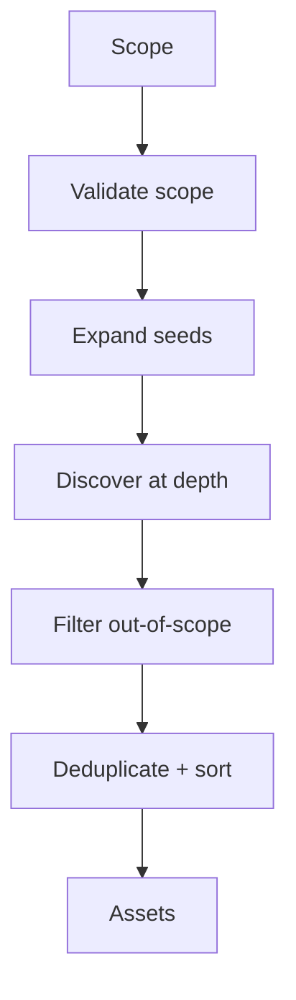

---
# MAM Metadata
id: recon
name: Recon
version: 2.0.0
type: module

author: MAM Team

description: >
  Discovers publicly authorized assets within a declared scope and returns a
  structured, deduplicated asset list for downstream analysis.

license: MIT

runtime:
  language: python
  version: ">=3.12"

tags:
  - security
  - recon

dependencies: []

capabilities:
  - discover

permissions:
  network:
    - internet
  filesystem:
    - read
---

# Recon

## Purpose

Discovers publicly authorized assets within a declared scope. The module never
scans outside `scope`, deduplicates results, and tags every asset with the
discovery depth that produced it so the analyzer can weigh evidence.

## Inputs

| Name | Type | Required | Description |
|------|------|----------|-------------|
| scope | string | Yes | Authorized scope (for example a domain) |
| depth | int | No | Discovery depth (default: 1) |
| seeds | list | No | Extra starting hosts inside the scope |

## Outputs

| Name | Type | Description |
|------|------|-------------|
| assets | list | Discovered assets: `{asset, kind, depth}` |
| skipped | list | Out-of-scope seeds that were refused |

## Capabilities

### discover

Enumerate assets within the authorized scope.

## Rules

- Operate only against authorized targets.
- Never perform destructive actions.
- Refuse any seed that is not inside the declared scope.
- Return deterministic ordering so runs are reproducible.
- Deduplicate assets before returning them.

## Workflow



## Python

```python
from typing import Any, Dict, List


class OutOfScopeError(ValueError):
    """Raised when a target is not inside the authorized scope."""


def _in_scope(host: str, scope: str) -> bool:
    host = host.strip().lower().rstrip(".")
    scope = scope.strip().lower().rstrip(".")
    return host == scope or host.endswith("." + scope)


def discover(scope: str, depth: int = 1, seeds: List[str] | None = None) -> Dict[str, Any]:
    """Return discovered assets for a scope, deduplicated and sorted."""
    if not scope or not scope.strip():
        raise OutOfScopeError("scope must not be empty")
    if depth < 1:
        raise ValueError("depth must be >= 1")

    assets: Dict[str, Dict[str, Any]] = {}
    skipped: List[str] = []

    candidates: List[tuple[str, int]] = [(scope, 0)]
    for seed in seeds or []:
        if _in_scope(seed, scope):
            candidates.append((seed, 1))
        else:
            skipped.append(seed)

    frontier = candidates
    for level in range(1, depth + 1):
        next_frontier: List[tuple[str, int]] = []
        for host, _ in frontier:
            key = host.strip().lower().rstrip(".")
            if key in assets:
                continue
            assets[key] = {
                "asset": key,
                "kind": "host" if level == 1 else "subdomain",
                "depth": level,
            }
            if level < depth and "." in key:
                next_frontier.append(("www." + key, level + 1))
        frontier = next_frontier

    return {
        "assets": sorted(assets.values(), key=lambda a: a["asset"]),
        "skipped": skipped,
    }
```

## Tests

### Input

```yaml
scope: example.com
depth: 2
```

### Expected

```yaml
assets: present
skipped: []
```

```python
def test_discover_scope_only() -> None:
    result = discover("example.com", depth=1, seeds=["evil.test"])
    assert result["skipped"] == ["evil.test"]
    assert all(a["asset"].endswith("example.com") for a in result["assets"])


def test_discover_deduplicates() -> None:
    result = discover("example.com", depth=1, seeds=["example.com"])
    assert len({a["asset"] for a in result["assets"]}) == len(result["assets"])
```

## Examples

```python
result = discover("example.com", depth=2)
print(len(result["assets"]))
```

## References

- MAM documentation
- plan-doc/full-mam.md
