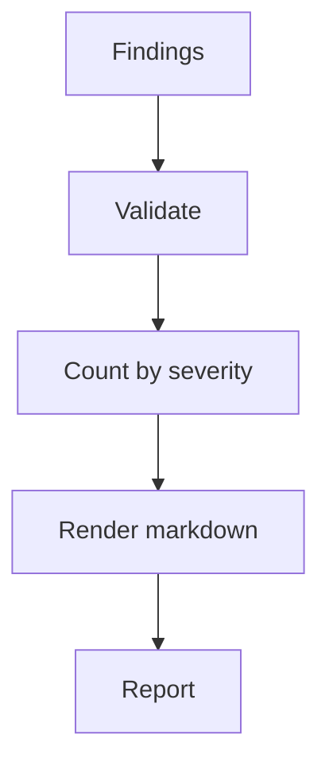

---
# MAM Metadata
id: reporter
name: Reporter
version: 2.0.0
type: module

author: MAM Team

description: >
  Produces a structured security report from ranked findings, with per-severity
  counts and a deterministic markdown body.

license: MIT

runtime:
  language: python
  version: ">=3.12"

tags:
  - security
  - reporting

dependencies:
  - name: analyzer
    version: ">=2.0.0"

capabilities:
  - report

permissions:
  filesystem:
    - write
---

# Reporter

## Purpose

Turns ranked findings into a structured report suitable for stakeholders. The
report body is deterministic: the same findings always produce the same markdown,
which makes reports diffable and safe to store.

## Inputs

| Name | Type | Required | Description |
|------|------|----------|-------------|
| findings | list | Yes | Ranked findings from analysis |
| title | string | No | Report title (default: "Security Report") |

## Outputs

| Name | Type | Description |
|------|------|-------------|
| report | object | `{title, counts, body, generated_at}` |

## Capabilities

### report

Generate a structured report from findings.

## Rules

- Findings must be validated before reporting.
- Counts must equal the number of findings by severity.
- The body must list findings in severity order.
- Never include secrets or raw credentials in the body.

## Workflow



## Python

```python
from datetime import datetime, timezone
from typing import Any, Dict, List

SEVERITY_ORDER = ["critical", "high", "medium", "low", "info"]
VALID_SEVERITIES = set(SEVERITY_ORDER)


def report(findings: List[Dict[str, Any]], title: str = "Security Report") -> Dict[str, Any]:
    """Build a deterministic structured report from findings."""
    counts = {level: 0 for level in SEVERITY_ORDER}
    lines = [f"# {title}", ""]

    for finding in findings:
        severity = str(finding.get("severity", "info")).lower()
        if severity not in VALID_SEVERITIES:
            raise ValueError(f"unknown severity: {severity}")
        counts[severity] += 1
        lines.append(f"- [{severity}] {finding.get('asset', 'unknown')}")

    lines += ["", "## Counts", ""]
    lines += [f"- {level}: {counts[level]}" for level in SEVERITY_ORDER if counts[level]]

    return {
        "title": title,
        "counts": counts,
        "body": "\n".join(lines),
        "generated_at": datetime.now(timezone.utc).isoformat(),
    }
```

## Tests

### Input

```yaml
findings:
  - asset: example.com
    severity: medium
```

### Expected

```yaml
report: present
```

```python
def test_report_counts() -> None:
    result = report([{"asset": "example.com", "severity": "medium"}])
    assert result["counts"]["medium"] == 1
    assert "example.com" in result["body"]


def test_report_rejects_unknown_severity() -> None:
    try:
        report([{"asset": "x", "severity": "urgent"}])
    except ValueError:
        return
    raise AssertionError("unknown severity must be rejected")
```

## Examples

```python
result = report([
    {"asset": "example.com", "severity": "medium"},
    {"asset": "admin.example.com", "severity": "high"},
])
print(result["counts"])
```

## References

- MAM documentation
- plan-doc/full-mam.md
