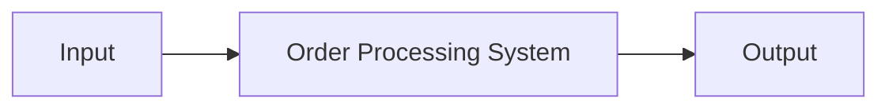

---
# MAM Metadata
id: examples-system
name: System System
version: 2.0.0
type: system

author: MAM Team

description: >
  Composes the system example modules into a runnable system: a composition
  root, a project manifest, and canonical .mam/.mam.md pairs under modules/.

license: MIT

runtime:
  language: python
  version: ">=3.12"

tags:
  - example
  - system
  - system

dependencies:
  - name: example-system
    version: ">=2.0.0"

capabilities:
  - validate_order
  - charge_order
  - fulfil_order
  - orchestrate

permissions:
  filesystem:
    - read
---

# System System

## Purpose

Entry system for the `system` example. It composes **Order Processing System** and keeps the folder
shape identical to every other example: a composing `system.mam`, a project `mam.toml`, and canonical `.mam`/`.mam.md` pairs under `modules/`.

## Inputs

| Name | Type | Required | Description |
|------|------|----------|-------------|
| mode | string | No | `demo` runs the composition; `validate` checks the wiring |
| payload | object | No | Optional input forwarded to the first module |

## Outputs

| Name | Type | Description |
|------|------|-------------|
| status | string | `ok` when the composition is wired |
| modules | list | Composed module ids in dependency order |
| capabilities | list | Union of the composed modules' capabilities |

## Modules

- **Order Processing System** (`example-system`) — A system is not a big module, it is a wiring decision.

## Capabilities

### `validate_order`

Delegates to **Order Processing System**.

### `charge_order`

Delegates to **Order Processing System**.

### `fulfil_order`

Delegates to **Order Processing System**.

### `orchestrate`

Delegates to **Order Processing System**.

## Rules

- Every order carries a non-empty `order_id`; two runs of the same id produce
- Totals are integer cents. No float ever touches an amount.
- Validation must run before charging; charging must run before fulfilment.
- A refusal names the stage that refused and never includes a later stage.
- The system exposes no partial success: the result is either a shipment or a
- No part performs I/O in this example; the effects are represented as data.

## Workflow



## Python

```python
MODULES = ["example-system"]
CAPABILITIES = ["validate_order", "charge_order", "fulfil_order", "orchestrate"]
EDGES = []


def run_system(mode="demo", payload=None):
    """Validate the composition and report what the system wires together."""
    if mode not in ("demo", "validate"):
        raise ValueError(f"unknown mode: {mode}")
    if len(set(MODULES)) != len(MODULES):
        return {"status": "error", "reason": "duplicate modules", "modules": MODULES}
    known = set(MODULES)
    dangling = [edge for edge in EDGES if edge[0] not in known or edge[1] not in known]
    if dangling:
        return {"status": "error", "reason": "dangling edge", "modules": MODULES}
    return {
        "status": "ok",
        "mode": mode,
        "modules": MODULES,
        "capabilities": CAPABILITIES,
        "edges": EDGES,
        "payload": payload,
    }
```

## Tests

### Input

```yaml
mode: demo
```

### Expected

```yaml
status: ok
```

```python
def test_system_composition():
    result = run_system("demo")
    assert result["status"] == "ok"
    assert result["modules"] == MODULES
    assert result["capabilities"] == CAPABILITIES
    assert result["edges"] == EDGES


def test_system_rejects_unknown_mode():
    try:
        run_system("deploy")
    except ValueError:
        return
    raise AssertionError("unknown mode must be rejected")
```

## Examples

```python
result = run_system("demo", {"target": "example.com"})
print(result["status"], len(result["modules"]))
```

## References

- [system README](./README.md)
- [Examples index](../README.md)
- [MAM specification](../../../plan-doc/full-mam.md)
