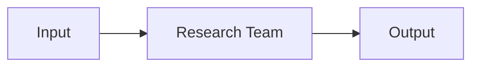

---
# MAM Metadata
id: examples-team
name: Team System
version: 2.0.0
type: system

author: MAM Team

description: >
  Composes the team example modules into a runnable system: a composition
  root, a project manifest, and canonical .mam/.mam.md pairs under modules/.

license: MIT

runtime:
  language: python
  version: ">=3.12"

tags:
  - example
  - system
  - team

dependencies:
  - name: example-team
    version: ">=2.0.0"

capabilities:
  - plan
  - delegate
  - compose

permissions:
  filesystem:
    - read
---

# Team System

## Purpose

Entry system for the `team` example. It composes **Research Team** and keeps the folder shape
identical to every other example: a composing `system.mam`, a project `mam.toml`, and canonical `.mam`/`.mam.md` pairs under `modules/`.

## Inputs

| Name | Type | Required | Description |
|------|------|----------|-------------|
| mode | string | No | `demo` runs the composition; `validate` checks the wiring |
| payload | object | No | Optional input forwarded to the first module |

## Outputs

| Name | Type | Description |
|------|------|-------------|
| status | string | `ok` when the composition is wired |
| modules | list | Composed module ids in dependency order |
| capabilities | list | Union of the composed modules' capabilities |

## Modules

- **Research Team** (`example-team`) — A `team` is several agents with an explicit shape: who leads, who reports to whom, and what a handoff carries.

## Capabilities

### `plan`

Delegates to **Research Team**.

### `delegate`

Delegates to **Research Team**.

### `compose`

Delegates to **Research Team**.

## Rules

- Exactly one Planner and one Writer may exist; any number of Researchers may
- A researcher may only answer sub-questions assigned to it by a handoff.
- A finding without at least one citation is dropped and recorded as a gap.
- The writer must not invent facts; every sentence must trace to a finding.
- When the number of surviving citations is below `min_citations` the answer is
- Handoffs are append-only; the transcript is never rewritten.

## Workflow



## Python

```python
MODULES = ["example-team"]
CAPABILITIES = ["plan", "delegate", "compose"]
EDGES = []


def run_system(mode="demo", payload=None):
    """Validate the composition and report what the system wires together."""
    if mode not in ("demo", "validate"):
        raise ValueError(f"unknown mode: {mode}")
    if len(set(MODULES)) != len(MODULES):
        return {"status": "error", "reason": "duplicate modules", "modules": MODULES}
    known = set(MODULES)
    dangling = [edge for edge in EDGES if edge[0] not in known or edge[1] not in known]
    if dangling:
        return {"status": "error", "reason": "dangling edge", "modules": MODULES}
    return {
        "status": "ok",
        "mode": mode,
        "modules": MODULES,
        "capabilities": CAPABILITIES,
        "edges": EDGES,
        "payload": payload,
    }
```

## Tests

### Input

```yaml
mode: demo
```

### Expected

```yaml
status: ok
```

```python
def test_system_composition():
    result = run_system("demo")
    assert result["status"] == "ok"
    assert result["modules"] == MODULES
    assert result["capabilities"] == CAPABILITIES
    assert result["edges"] == EDGES


def test_system_rejects_unknown_mode():
    try:
        run_system("deploy")
    except ValueError:
        return
    raise AssertionError("unknown mode must be rejected")
```

## Examples

```python
result = run_system("demo", {"target": "example.com"})
print(result["status"], len(result["modules"]))
```

## References

- [team README](./README.md)
- [Examples index](../README.md)
- [MAM specification](../../../plan-doc/full-mam.md)
