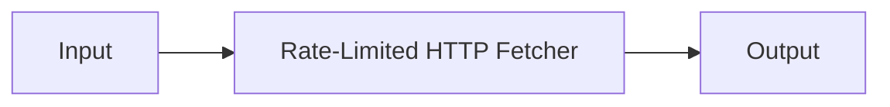

---
# MAM Metadata
id: examples-tool
name: Tool System
version: 2.0.0
type: system

author: MAM Team

description: >
  Composes the tool example modules into a runnable system: a composition
  root, a project manifest, and canonical .mam/.mam.md pairs under modules/.

license: MIT

runtime:
  language: python
  version: ">=3.12"

tags:
  - example
  - system
  - tool

dependencies:
  - name: example-tool
    version: ">=2.0.0"

capabilities:
  - fetch
  - acquire_token

permissions:
  filesystem:
    - read
---

# Tool System

## Purpose

Entry system for the `tool` example. It composes **Rate-Limited HTTP Fetcher** and keeps the folder
shape identical to every other example: a composing `system.mam`, a project `mam.toml`, and canonical `.mam`/`.mam.md` pairs under `modules/`.

## Inputs

| Name | Type | Required | Description |
|------|------|----------|-------------|
| mode | string | No | `demo` runs the composition; `validate` checks the wiring |
| payload | object | No | Optional input forwarded to the first module |

## Outputs

| Name | Type | Description |
|------|------|-------------|
| status | string | `ok` when the composition is wired |
| modules | list | Composed module ids in dependency order |
| capabilities | list | Union of the composed modules' capabilities |

## Modules

- **Rate-Limited HTTP Fetcher** (`example-tool`) — A `tool` is something an agent calls with arguments and gets a typed result back.

## Capabilities

### `fetch`

Delegates to **Rate-Limited HTTP Fetcher**.

### `acquire_token`

Delegates to **Rate-Limited HTTP Fetcher**.

## Rules

- The tool is idempotent per URL: repeating a call with the same arguments
- The tool is side-effecting: it performs outbound requests and mutates the
- Only `http` and `https` schemes are accepted; other schemes return
- Retries use exponential backoff of 0.5, 1.0, 2.0 seconds capped at 3 attempts.
- A 4xx response is never retried because it will not become a 2xx.
- The tool never raises; every failure mode is reported in the result.

## Workflow



## Python

```python
MODULES = ["example-tool"]
CAPABILITIES = ["fetch", "acquire_token"]
EDGES = []


def run_system(mode="demo", payload=None):
    """Validate the composition and report what the system wires together."""
    if mode not in ("demo", "validate"):
        raise ValueError(f"unknown mode: {mode}")
    if len(set(MODULES)) != len(MODULES):
        return {"status": "error", "reason": "duplicate modules", "modules": MODULES}
    known = set(MODULES)
    dangling = [edge for edge in EDGES if edge[0] not in known or edge[1] not in known]
    if dangling:
        return {"status": "error", "reason": "dangling edge", "modules": MODULES}
    return {
        "status": "ok",
        "mode": mode,
        "modules": MODULES,
        "capabilities": CAPABILITIES,
        "edges": EDGES,
        "payload": payload,
    }
```

## Tests

### Input

```yaml
mode: demo
```

### Expected

```yaml
status: ok
```

```python
def test_system_composition():
    result = run_system("demo")
    assert result["status"] == "ok"
    assert result["modules"] == MODULES
    assert result["capabilities"] == CAPABILITIES
    assert result["edges"] == EDGES


def test_system_rejects_unknown_mode():
    try:
        run_system("deploy")
    except ValueError:
        return
    raise AssertionError("unknown mode must be rejected")
```

## Examples

```python
result = run_system("demo", {"target": "example.com"})
print(result["status"], len(result["modules"]))
```

## References

- [tool README](./README.md)
- [Examples index](../README.md)
- [MAM specification](../../../plan-doc/full-mam.md)
