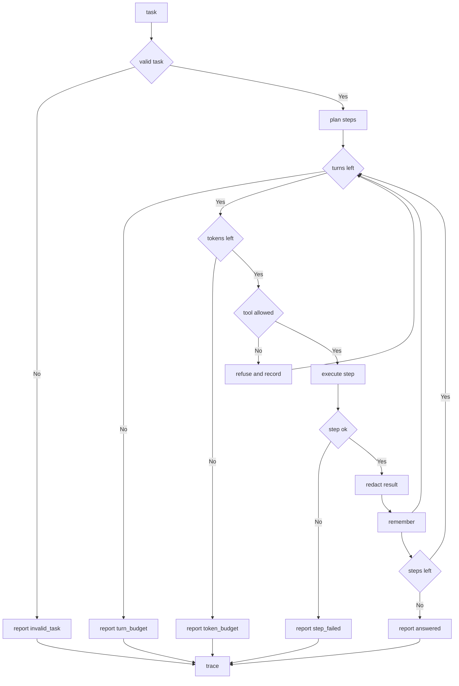

---
# MAM Metadata
id: template-agent-advanced
name: Agent Template (Advanced)
version: 2.0.0
type: agent

author: MAM Team
description: >
  A production agent with tool and token budgets, a pre and post action
  guardrail policy, refusal handling and per run observability.

license: MIT

runtime:
  language: python
  version: ">=3.12"

tags:
  - template
  - agent
  - advanced
  - guardrails
  - observability

dependencies:
  - name: mam-runtime
    version: ">=1.0.0"
  - name: mam-permissions
    version: ">=1.0.0"
  - name: telemetry
    version: "^2.0"

capabilities:
  - plan
  - execute
  - remember
  - guard
  - report

permissions:
  filesystem:
    - read
  memory:
    - local
  python:
    - sandbox
  network:
    - internet
---

# Agent Template (Advanced)

## Purpose

The basic agent, plus everything a long lived agent needs. It declares a tool
budget and a token budget, screens every step through a guard policy before and
after it runs, reports a stable stop reason and an error code for every run,
and emits a trace that says what happened without echoing secrets. Use it as
the base for any agent that other systems will call unattended.

## Inputs

| Name | Type | Required | Description |
|------|------|----------|-------------|
| task | string | Yes | Question or instruction for the agent |
| context | object | No | Notes the agent may read instead of starting empty |
| max_turns | number | No | Tool step cap. Defaults to 8 |
| max_tokens | number | No | Token budget for the whole run. Defaults to 4000 |
| policy | object | No | Extra deny rules layered onto the default policy |

## Outputs

| Name | Type | Description |
|------|------|-------------|
| answer | string | Result of the last successful step, empty on refusal or failure |
| turns | array | One record per executed step, including refusals |
| stop_reason | string | `answered`, `turn_budget`, `token_budget`, `refused`, `failed` or `no_task` |
| code | string | Stable machine readable reason, empty when the run succeeded |
| tokens_used | number | Tokens charged against the run budget |
| trace | object | Counts and timings for the run |

## Agent Identity

The Advanced Agent is a long-lived research worker that other systems call
unattended. It is the same shape as the basic agent — one task, one run, one
answer — wrapped in the controls a production caller needs: hard budgets, a
pre/post guard policy, stable machine-readable codes and a trace that never
echoes secrets.

It does not negotiate, retry or wait. When a budget is exhausted or a step is
refused it stops with an explicit `stop_reason` and the partial answer, so the
caller can decide what happens next without guessing.

## Role Description

This agent is the authority on the task it was given and the only party allowed
to spend its budgets. It collaborates with the caller (which supplies the task
and reads the trace) and with the host runtime (which enforces the sandbox). It
never edits its own policy, never extends its own budget and never hides a
refusal.

## Profile

| Attribute | Value |
|-----------|-------|
| Agent ID | `template-agent-advanced` |
| Category | `agent` |
| Specialization | Budgeted, guarded single-task research |
| Primary tools | `notes.read`, `notes.write`, `http.fetch` |
| Memory | local, namespaced per agent |
| Deny list | `shell.rm`, `http.internal` (plus caller additions) |
| Termination | `answered`, `turn_budget`, `token_budget`, `refused`, `failed`, `no_task` |
| Latency budget | Under 250 ms for 8 steps |
| Failure mode | Explicit code + partial answer, never a silent stop |

## Capabilities

### plan

Turn the task into the ordered list of tool steps the agent will attempt, in
allow-list order.

### execute

Run one step through the allow list, charging it against the run budgets.

### remember

Write a value into the agent's notes, subject to the redaction rules.

### guard

Screen the agent and each step against the policy before and after execution.

### report

Summarize the run as counts, a stop reason and a stable code.

## Core Competencies

### 1. Budget enforcement

Turns and tokens are charged by the agent, not the caller. A step that would
cross either limit is never started.

### 2. Pre-action screening

Every step is checked against the allow list and the deny list before it runs.
Refusals are recorded as turns with a stable code.

### 3. Post-action validation

A step that returns `ok: false` becomes `failed`/`step_failed`; the run stops
with the evidence attached.

### 4. Redaction

Any step result containing a secret marker is replaced with `[redacted]` before
it reaches the notes or the trace. The step is kept with `code: redacted`.

### 5. Partial answers

A run that exhausts a budget still reports the answer accumulated so far,
marked with the budget stop reason.

### 6. Stable error taxonomy

Every non-success run carries exactly one code from the documented table, so
callers branch on codes rather than message text.

### 7. Observability by default

Every run returns counts (turns, refused, failed), the tools touched and a
duration; values are never echoed.

### 8. Policy layering

Caller-supplied deny rules are added to the default deny list; nothing can
remove a default denial.

## Response Format Template

```json
{
  "answer": "answer for what is mam",
  "stop_reason": "answered",
  "code": "",
  "tokens_used": 750,
  "turns": [
    {"tool": "notes.read", "ok": true, "code": "", "value": "a module format"},
    {"tool": "notes.write", "ok": true, "code": "", "value": "answer for what is mam"},
    {"tool": "http.fetch", "ok": true, "code": "", "value": "fetched what is mam"}
  ],
  "trace": {"turns": 3, "refused": 0, "failed": 0, "tools": ["http.fetch", "notes.read", "notes.write"], "duration_ms": 0.4}
}
```

## Decision-Making Framework

| Situation | Decision | `stop_reason` / `code` |
|-----------|----------|------------------------|
| Task empty or not a string | Do not plan | `no_task` / `invalid_task` |
| Turn budget exhausted | Stop before next step | `turn_budget` / `""` |
| Token budget exhausted | Stop before next step | `token_budget` / `""` |
| Tool not on allow list | Record refusal | `refused` / `tool_not_allowed` |
| Tool on deny list | Record refusal | `refused` / `tool_denied` |
| Step returned failure | Stop with evidence | `failed` / `step_failed` |
| All steps succeeded | Report answer | `answered` / `""` |

Ambiguity rule: prefer refusing a single step over failing the whole run; prefer
stopping over spending the last token.

## Communication Style

- **With callers:** one result object; branch on `stop_reason` and `code`.
- **With on-call engineers:** the trace is the incident summary; quote counts,
  not values.
- **With other agents:** never delegate; this agent is a leaf.
- **In logs:** tool names, codes and durations only — no note contents.

## Agent Definition

```text
module ResearchAgent

type:
    agent

role:
    Research

goal:
    Answer a task from its own notes within a bounded budget

tools:
    - notes.read
    - notes.write
    - http.fetch

memory:
    local

budgets:
    max_turns: 8
    max_tokens: 4000

policy:
    GuardPolicy

telemetry:
    trace
```

## Budgets

| Budget | Default | Exhausted stop reason |
|--------|---------|-----------------------|
| `max_turns` | 8 | `turn_budget` |
| `max_tokens` | 4000 | `token_budget` |

A step that would push the run past `max_tokens` is not started. The agent
stops with `token_budget` and reports the answer so far, partial rather than
empty.

## Guardrails

| Stage | Check | On failure |
|-------|-------|------------|
| Pre-agent | Task is non-empty and is a string | `no_task` |
| Pre-step | Tool is on the allow list | `refused` / `tool_not_allowed` |
| Pre-step | Turn budget remains | `turn_budget` |
| Pre-step | Token budget remains | `token_budget` |
| Pre-step | Tool is not on the deny list | `refused` / `tool_denied` |
| Post-step | Step returned `ok` | `failed` |
| Post-step | Result contains no secret pattern | answer redacted, step kept |

## Error Codes

| Code | Meaning |
|------|---------|
| `tool_not_allowed` | The planner produced a step outside the allow list |
| `tool_denied` | The policy explicitly denies the tool |
| `step_failed` | The step ran and returned a failure |
| `redacted` | A step result matched a secret pattern and was scrubbed |
| `invalid_task` | The task was not a non-empty string |

## Permissions

| Scope | Access | Reason |
|-------|--------|--------|
| filesystem | read | Read local context files |
| memory | local | Read and write agent notes |
| python | sandbox | Execute steps in a sandbox |
| network | internet | Let the agent reach an approved upstream only |

## Integration Patterns with Other Agents

- **Coordinator:** calls this agent for bounded research and reads `answer`,
  `stop_reason`, `code` and `trace`.
- **Policy service:** supplies additional deny rules; it cannot remove defaults.
- **Telemetry sink:** receives the trace object; it never receives step values.
- **Human reviewer:** consumes the code taxonomy to decide retries.
- **No handoffs:** delegation belongs to the full multi-agent template.

## Rules

- Every step is screened before it runs and again after it returns.
- A denied or disallowed step is recorded and counted, never silently dropped.
- Budgets are enforced by the agent, not by the caller.
- A run that exhausts either budget still reports a partial answer.
- Redaction happens before a step result reaches the transcript or the trace.
- Errors are values: a run returns a code, it does not raise to the caller.
- Every failure is recorded in the trace so a silent stop is impossible.

## Workflow



## Python

```python
import time
from typing import Any, Dict, List, Set

MAX_TURNS = 8
MAX_TOKENS = 4000
TOKENS_PER_STEP = 250
SECRET_MARKERS = ("password", "api_key", "token")

ALLOWED_TOOLS = ("notes.read", "notes.write", "http.fetch")
DEFAULT_DENY = ("shell.rm", "http.internal")


class Agent:
    """A bounded agent: budgets, guardrails, stable codes and a trace."""

    role = "Research"
    goal = "Answer a task from its own notes within a bounded budget"

    def __init__(self, notes: Dict[str, Any] = None, max_turns: int = MAX_TURNS,
                 max_tokens: int = MAX_TOKENS, deny: List[str] = None) -> None:
        self.notes: Dict[str, Any] = dict(notes or {})
        self.max_turns = max_turns
        self.max_tokens = max_tokens
        self.deny: Set[str] = set(DEFAULT_DENY) | set(deny or [])
        self.tokens_used = 0
        self.refusals: List[str] = []

    def guard(self, step: str) -> Dict[str, Any]:
        """Screen a step before it runs."""
        if step not in ALLOWED_TOOLS:
            return {"allowed": False, "code": "tool_not_allowed"}
        if step in self.deny:
            return {"allowed": False, "code": "tool_denied"}
        return {"allowed": True, "code": ""}

    def _redact(self, value: Any) -> Any:
        if not isinstance(value, str):
            return value
        lowered = value.lower()
        if any(marker in lowered for marker in SECRET_MARKERS):
            return "[redacted]"
        return value

    def plan(self, task: str) -> List[str]:
        """Plan the ordered steps for a task."""
        if not task:
            return []
        return list(ALLOWED_TOOLS)

    def execute(self, task: str, step: str) -> Dict[str, Any]:
        """Run one screened step and charge it against the run budgets."""
        verdict = self.guard(step)
        if not verdict["allowed"]:
            self.refusals.append(step)
            return {"tool": step, "ok": False, "code": verdict["code"], "value": ""}

        self.tokens_used += TOKENS_PER_STEP
        if step == "notes.read":
            value = self.notes.get(task, "")
        elif step == "notes.write":
            value = self.remember(f"answer:{task}", f"answer for {task}")
        else:
            value = f"fetched {task}"

        value = self._redact(value)
        code = "redacted" if value == "[redacted]" else ""
        return {"tool": step, "ok": True, "code": code, "value": value}

    def remember(self, key: str, value: Any) -> Any:
        """Write a value into the agent's notes."""
        self.notes[key] = value
        return value

    def report(self, stop_reason: str, code: str, turns: List[Dict[str, Any]],
               started: float) -> Dict[str, Any]:
        """Summarize the run without echoing step values."""
        failed = [turn for turn in turns if not turn["ok"]]
        return {
            "stop_reason": stop_reason,
            "code": code,
            "tokens_used": self.tokens_used,
            "turns": turns,
            "trace": {
                "turns": len(turns),
                "refused": len(self.refusals),
                "failed": len(failed),
                "tools": sorted({turn["tool"] for turn in turns}),
                "duration_ms": round((time.perf_counter() - started) * 1000, 3),
            },
        }

    def run(self, task: str) -> Dict[str, Any]:
        """Run the agent once under budget, guardrail and trace enforcement."""
        started = time.perf_counter()
        if not isinstance(task, str) or not task:
            out = self.report("no_task", "invalid_task", [], started)
            out["answer"] = ""
            return out

        self.tokens_used = 0
        self.refusals = []
        steps = self.plan(task)
        turns: List[Dict[str, Any]] = []
        stop_reason, code = "answered", ""

        for step in steps:
            if len(turns) >= self.max_turns:
                stop_reason, code = "turn_budget", ""
                break
            if self.tokens_used + TOKENS_PER_STEP > self.max_tokens:
                stop_reason, code = "token_budget", ""
                break

            turn = self.execute(task, step)
            turns.append(turn)
            if not turn["ok"]:
                if turn["code"] in ("tool_not_allowed", "tool_denied"):
                    stop_reason, code = "refused", turn["code"]
                else:
                    stop_reason, code = "failed", turn["code"]
                break

        out = self.report(stop_reason, code, turns, started)
        out["answer"] = self.notes.get(f"answer:{task}", "")
        return out
```

## Tests

### Input

```yaml
task: what is mam
context:
  what is mam: a module format
max_turns: 8
max_tokens: 4000
```

### Expected

```yaml
answer: "answer for what is mam"
stop_reason: answered
code: ""
tokens_used: 750
```

```python
def test_successful_run_reports_observability():
    agent = Agent(notes={"what is mam": "a module format"})
    out = agent.run("what is mam")
    assert out["stop_reason"] == "answered"
    assert out["code"] == ""
    assert out["answer"] == "answer for what is mam"
    assert out["tokens_used"] == 750
    assert out["trace"]["tools"] == ["http.fetch", "notes.read", "notes.write"]
    assert out["trace"]["failed"] == 0
    assert out["trace"]["duration_ms"] >= 0


def test_invalid_task_is_a_code_not_an_exception():
    out = Agent().run("")
    assert out["stop_reason"] == "no_task"
    assert out["code"] == "invalid_task"
    assert out["trace"]["turns"] == 0


def test_turn_budget_stops_the_loop():
    out = Agent(max_turns=1).run("what is mam")
    assert out["stop_reason"] == "turn_budget"
    assert len(out["turns"]) == 1


def test_token_budget_stops_before_the_step():
    out = Agent(max_tokens=200).run("what is mam")
    assert out["stop_reason"] == "token_budget"
    assert out["turns"] == []
    assert out["tokens_used"] == 0


def test_denied_tool_is_refused_and_recorded():
    out = Agent(deny=["http.fetch"]).run("what is mam")
    assert out["stop_reason"] == "refused"
    assert out["code"] == "tool_denied"
    assert out["trace"]["refused"] == 1
    assert out["turns"][-1]["tool"] == "http.fetch"
    assert out["turns"][-1]["ok"] is False


def test_unlisted_tool_is_refused():
    assert Agent().guard("shell.rm")["code"] == "tool_not_allowed"


def test_secret_results_are_redacted():
    agent = Agent(notes={"what is mam": "token: hunter2"})
    turn = agent.execute("what is mam", "notes.read")
    assert turn["code"] == "redacted"
    assert turn["value"] == "[redacted]"


def test_trace_never_echoes_step_values():
    out = Agent(notes={"what is mam": "a module format"}).run("what is mam")
    assert "a module format" not in str(out["trace"])
```

## Examples

```python
agent = Agent(notes={"what is mam": "a module format"}, max_turns=2)
out = agent.run("what is mam")
print(out["stop_reason"], out["code"])   # answered
print(out["trace"]["tools"])            # ['notes.read', 'notes.write']
print(out["tokens_used"])               # 500

result = Agent(notes={"what is mam": "a module format"}).run("what is mam")
print(result["answer"])
```

### Expected Flow

```text
task -> guard -> plan -> execute -> redact -> remember -> report -> trace
```

## Best Practices

- Set budgets from measured runs, then add headroom; never from optimism.
- Keep the deny list small and absolute; allow-list everything else.
- Treat codes as a public API and version them with the module.
- Redact before persisting, not after logging.
- Assert the trace shape in tests; observability regressions are silent.

## Common Anti-Patterns

- **Retrying on the caller's behalf.** Retries hide budget burn.
- **Catching and swallowing step errors.** A silent failure is not a success.
- **Logging the note contents.** Secrets move through notes.
- **Mutable default deny list.** Callers must not be able to remove defaults.
- **Token accounting after the step.** Check before spending.

## Performance Optimization Patterns

- Charge tokens before execution so the budget check is O(1).
- Keep the plan static per task; never re-plan inside the loop.
- Build the trace from counters, not by scanning turns repeatedly.
- Stop at the first refusal; continuing only burns budget.
- Benchmark with a fixed corpus; 8 steps should stay under 250 ms.

## Security Considerations

- The deny list is a floor, not a ceiling; pair it with host-level sandboxing.
- Secret markers are heuristics; never rely on them as the only control.
- Do not echo note values into traces, errors or codes.
- Reject non-string tasks before they reach the policy engine.
- Treat `http.fetch` as internet access and require an explicit permission.

## Troubleshooting Guide

| Symptom | Likely cause | Action |
|---------|--------------|--------|
| `token_budget` immediately | `max_tokens` below one step | raise above `TOKENS_PER_STEP` |
| `refused` on a valid tool | caller deny list shadows it | inspect combined deny set |
| Answer empty after budget stop | no `notes.write` ran yet | allow one write before fetch |
| Trace has no tools | plan returned empty | check task trimming |
| Values in logs | redaction bypassed | route payloads through `_redact` |

## Quick Reference Card

- Budgets: 8 turns, 4000 tokens, 250 tokens per step.
- Allow: notes.read, notes.write, http.fetch. Deny: shell.rm, http.internal.
- Codes: `tool_not_allowed`, `tool_denied`, `step_failed`, `redacted`,
  `invalid_task`.
- Always return `answer`, `stop_reason`, `code`, `tokens_used`, `trace`.
- Never echo step values.

## References

- [MAM Agent Specification](../../spec/sections/)
- [Agent Template (full)](./agent.mam)
- [MAM Permission Model](../../spec/sections/)
- [MAM Specification](../../plan-doc/full-mam.md)
