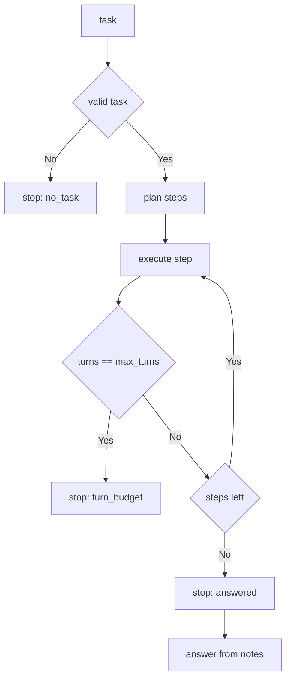

---
# MAM Metadata
id: template-agent-basic
name: Agent Template (Basic)
version: 2.0.0
type: agent

author: MAM Team

description: >
  A single agent with one role, one goal, a fixed tool list and a bounded
  observe-and-act loop that stops on a terminal answer.

license: MIT

runtime:
  language: python
  version: ">=3.12"

tags:
  - template
  - agent
  - basic
  - single-agent

dependencies:
  - name: mam-runtime
    version: ">=1.0.0"

capabilities:
  - validate
  - plan
  - execute
  - remember

permissions:
  filesystem:
    - read
  memory:
    - local
  python:
    - sandbox
---

# Agent Template (Basic)

## Purpose

One agent, one job. It receives a task, plans a short ordered list of tool
steps, runs them in order, writes what it learned back into its own notes and
then stops with an explicit reason. Use
[`agent.mam`](../agent.mam) for a coordinator and a worker sharing a policy, and
[`agent-advanced.mam`](./agent-advanced.mam) for budgets, guardrails and
observability.

## Inputs

| Name | Type | Required | Description |
|------|------|----------|-------------|
| task | string | Yes | Question or instruction for the agent |
| context | object | No | Notes the agent may read instead of starting empty |
| max_turns | number | No | Hard cap on tool steps per run. Defaults to 3 |

## Outputs

| Name | Type | Description |
|------|------|-------------|
| answer | string | Result produced by the last successful step, empty if none |
| turns | array | One record per executed tool step |
| notes | object | Notes written during this run |
| stop_reason | string | `answered`, `turn_budget` or `no_task` |

## Agent Identity

The Basic Agent is a single-shot research worker. It owns one task at a time,
reads only from its own notes and returns one answer. It is the smallest useful
agent shape: a role, a goal, two tools and a stopping rule. Anything that needs
delegation, budgets or external side effects belongs in the full or advanced
template.

It does not negotiate, does not ask follow-up questions and does not retry. If
the task is empty it stops immediately; if the turn budget runs out it stops
with a partial answer and says so.

## Role Description

This agent is the authority on the task it was given and on the notes it owns.
It collaborates with exactly one other party: the caller. It produces an answer,
the tool steps that produced it, and the notes it wrote. It never writes outside
its own memory namespace, never calls a tool that is not on its allow list, and
never continues after a terminal stop reason.

## Profile

| Attribute | Value |
|-----------|-------|
| Agent ID | `template-agent-basic` |
| Category | `agent` |
| Specialization | Single-task research from local notes |
| Primary tools | `notes.read`, `notes.write` |
| Memory | local, namespaced per agent |
| Handoff targets | none |
| Termination | `answered`, `turn_budget` or `no_task` |
| Latency budget | Under 10 ms per task |
| Failure mode | Stop with an explicit reason, never loop |

## Capabilities

### validate

Reject a missing or non-string task before planning anything.

### plan

Turn the task into the ordered list of tool steps the agent will run.

### execute

Run one planned step through the agent's allow list and return its record.

### remember

Write a value into the agent's notes so later steps and later runs can read it.

## Core Competencies

### 1. Single-task focus

One call handles one task. The agent never queues, defers or accepts a second
task in the same run.

### 2. Deterministic planning

The plan is derived from the task text and the static tool list, never from a
model. The same task always produces the same steps.

### 3. Allow-list enforcement

Every tool call is checked against the allow list before execution. An unlisted
tool returns `ok: false` with `tool not allowed` and the run continues.

### 4. Explicit stop reasons

A run ends with exactly one of `answered`, `turn_budget` or `no_task`. There is
no implicit success.

### 5. Notes ownership

Notes live in the agent's own namespace. Keys written by one task are readable
by later tasks of the same agent and invisible to other agents.

### 6. Bounded turns

`max_turns` is enforced inside the loop. A caller cannot extend it mid-run.

### 7. Answer provenance

The reported answer is read back from notes, so the answer and the write step
can never disagree.

### 8. Failure containment

An invalid or empty task is a stop reason, not an exception. A refused tool is a
recorded turn, not a crash.

## Response Format Template

```json
{
  "task": "what is mam",
  "answer": "answer for what is mam",
  "turns": [
    {"tool": "notes.read", "ok": true, "value": "a module format"},
    {"tool": "notes.write", "ok": true, "value": "answer for what is mam"}
  ],
  "notes": {"answer:what is mam": "answer for what is mam"},
  "stop_reason": "answered"
}
```

## Decision-Making Framework

| Situation | Decision | Stop reason |
|-----------|----------|-------------|
| Task missing or empty | Do not plan | `no_task` |
| Task present, steps planned | Execute in order | — |
| Turn count reaches `max_turns` | Stop with partial answer | `turn_budget` |
| All planned steps executed | Stop with recorded answer | `answered` |
| Tool not on allow list | Record refusal, continue | unchanged |

Ambiguity rule: when a task cannot be planned, return `no_task` rather than
inventing steps.

## Communication Style

- **With the caller:** one result object, no prose.
- **With humans debugging:** quote the `turns` array; it is the audit trail.
- **With other agents:** none — this template has no handoffs.
- **In logs:** tool name and outcome only; never the note contents.

## Tool Access and Capabilities

| Tool | Effect | Side effects |
|------|--------|---------------|
| `notes.read` | Read the value stored for the task | None |
| `notes.write` | Store the answer for the task | Writes to agent notes |

## Agent Definition

The basic agent is one `agent` module. It has no handoffs: it is the only
participant in its own system.

```text
module ResearchAgent

type:
    agent

role:
    Research

goal:
    Answer a task from its own notes without leaving the sandbox

tools:
    - notes.read
    - notes.write

memory:
    local
```

## Stop Conditions

| Condition | `stop_reason` | Meaning |
|-----------|---------------|---------|
| Every planned step ran | `answered` | The loop is finished and the answer is valid |
| `max_turns` reached | `turn_budget` | The loop was cut short, answer may be partial |
| Task was empty | `no_task` | Nothing was planned, so nothing ran |

## Integration Patterns with Other Agents

- **Coordinator:** may call this agent for a bounded research subtask and read
  only the `answer` and `stop_reason` fields.
- **Worker:** receives tasks from the coordinator without sharing notes.
- **Policy:** consulted before tool execution when the host enforces policies.
- **No handoffs:** this agent never delegates. If a task needs delegation, the
  caller should use `agent.mam` instead.

## Rules

- The agent only ever calls tools on its allow list.
- One task produces one run; the agent does not accept follow-up turns.
- `max_turns` is enforced inside the loop, not by the caller.
- An empty task is not an error: the agent stops with `no_task` and runs nothing.
- Notes live in the agent's own memory; the agent never reads another agent's notes.
- The agent writes its answer to notes before reporting it.
- A task that is not a string is rejected with `ValueError`.

## Workflow



## Python

```python
from typing import Any, Dict, List, Optional

MAX_TURNS = 3

ALLOWED_TOOLS = ("notes.read", "notes.write")


def validate_task(task: Any) -> str:
    """Return the task or raise when the input contract is violated."""
    if not isinstance(task, str):
        raise ValueError("task must be a string")
    return task


class Agent:
    """A single agent with a fixed tool list and an explicit stop reason."""

    role = "Research"
    goal = "Answer a task from its own notes without leaving the sandbox"

    def __init__(self, notes: Optional[Dict[str, Any]] = None, max_turns: int = MAX_TURNS) -> None:
        if max_turns < 1:
            raise ValueError("max_turns must be at least 1")
        self.notes: Dict[str, Any] = dict(notes or {})
        self.max_turns = max_turns
        self.written: Dict[str, Any] = {}

    def plan(self, task: str) -> List[str]:
        """Turn a task into the ordered tool steps that will run."""
        if not task.strip():
            return []
        return list(ALLOWED_TOOLS)

    def execute(self, task: str, step: str) -> Dict[str, Any]:
        """Run one planned step if it is on the allow list."""
        if step not in ALLOWED_TOOLS:
            return {"tool": step, "ok": False, "value": "tool not allowed"}
        key = f"answer:{task}"
        if step == "notes.read":
            return {"tool": step, "ok": True, "value": self.notes.get(task, "")}
        self.remember(key, f"answer for {task}")
        return {"tool": step, "ok": True, "value": self.notes[key]}

    def remember(self, key: str, value: Any) -> bool:
        """Write a value into the agent's notes."""
        self.notes[key] = value
        self.written[key] = value
        return True

    def run(self, task: str) -> Dict[str, Any]:
        """Run the agent once and report why it stopped."""
        validate_task(task)
        self.written = {}
        steps = self.plan(task)
        if not steps:
            return {"task": task, "answer": "", "turns": [], "notes": {}, "stop_reason": "no_task"}

        turns: List[Dict[str, Any]] = []
        stop_reason = "answered"
        for step in steps:
            turns.append(self.execute(task, step))
            if len(turns) >= self.max_turns:
                stop_reason = "turn_budget"
                break

        return {
            "task": task,
            "answer": self.notes.get(f"answer:{task}", ""),
            "turns": turns,
            "notes": dict(self.written),
            "stop_reason": stop_reason,
        }


def run(task: str, context: Optional[Dict[str, Any]] = None,
        max_turns: int = MAX_TURNS) -> Dict[str, Any]:
    return Agent(notes=context, max_turns=max_turns).run(task)
```

## Tests

### Input

```yaml
task: what is mam
context:
  what is mam: a module format
```

### Expected

```yaml
answer: "answer for what is mam"
stop_reason: answered
```

```python
def test_answers_and_stops():
    agent = Agent(notes={"what is mam": "a module format"})
    out = agent.run("what is mam")
    assert out["stop_reason"] == "answered"
    assert out["answer"] == "answer for what is mam"
    assert [turn["tool"] for turn in out["turns"]] == list(ALLOWED_TOOLS)


def test_empty_task_runs_nothing():
    agent = Agent()
    out = agent.run("   ")
    assert out["stop_reason"] == "no_task"
    assert out["turns"] == []
    assert out["answer"] == ""


def test_non_string_task_is_rejected():
    try:
        Agent().run(None)
    except ValueError:
        return
    raise AssertionError("expected ValueError")


def test_turn_budget_is_enforced():
    agent = Agent(max_turns=1)
    out = agent.run("what is mam")
    assert out["stop_reason"] == "turn_budget"
    assert len(out["turns"]) == 1


def test_unlisted_tool_is_refused():
    agent = Agent()
    turn = agent.execute("what is mam", "shell.rm")
    assert turn["ok"] is False
    assert turn["value"] == "tool not allowed"


def test_remember_is_readable_by_a_later_run():
    agent = Agent()
    agent.remember("owner", "mam team")
    assert agent.notes["owner"] == "mam team"


def test_notes_report_only_this_run():
    agent = Agent(notes={"what is mam": "a module format"})
    out = agent.run("what is mam")
    assert out["notes"] == {"answer:what is mam": "answer for what is mam"}


def test_run_helper_matches_agent():
    assert run("what is mam", {"what is mam": "a module format"}) == Agent(
        notes={"what is mam": "a module format"}
    ).run("what is mam")
```

## Examples

```python
agent = Agent(notes={"what is mam": "a module format"})
out = agent.run("what is mam")
print(out["stop_reason"])
print(out["answer"])

result = run("what is mam", {"what is mam": "a module format"})
print(result["turns"])
```

## Best Practices

- Keep the allow list short and explicit; every tool is a capability grant.
- Treat `stop_reason` as part of the API contract.
- Write the answer to notes before returning it, so the audit trail is complete.
- Namespace note keys by purpose (`answer:<task>`) to avoid collisions.
- Test the empty task and the turn budget explicitly.

## Common Anti-Patterns

- **Unbounded loops.** A model that keeps planning is a production incident.
- **Implicit success.** Returning an answer without a stop reason hides partial
  results.
- **Shared notes.** Reading another agent's notes breaks isolation.
- **Dynamic tool discovery.** Tools must be granted, not discovered at runtime.
- **Swallowing refusals.** A refused tool is data; record it.

## Performance Optimization Patterns

- Precompute the plan once per task; never re-plan inside the loop.
- Keep notes as a dict; avoid serialization on the hot path.
- Stop as soon as the budget is reached instead of checking after each step
  twice.
- Benchmark with a fixed corpus; target is under 10 ms per task.

## Security Considerations

- Treat the task as untrusted text; never interpolate it into shell commands.
- Notes must not store secrets; they are local, readable memory.
- Reject non-string tasks instead of coercing them.
- The sandbox permission is advisory; the host must enforce it.
- Log tool names and outcomes, never note contents.

## Troubleshooting Guide

| Symptom | Likely cause | Action |
|---------|--------------|--------|
| Always `no_task` | whitespace-only task | trim at ingress |
| `turn_budget` unexpectedly | `max_turns` too low | raise the budget or split the task |
| Answer empty | `notes.write` refused | check the allow list |
| KeyError in notes | unnamespaced keys | use `answer:<task>` |
| Notes leak across runs | shared dict passed by caller | copy the context |

## Quick Reference Card

- One task, one run, one stop reason.
- Tools: `notes.read`, `notes.write` only.
- Budget: 3 turns by default.
- Empty task → `no_task`; budget hit → `turn_budget`.
- Answer comes from notes, never from a local variable.

## References

- [MAM Agent Specification](../../../spec/sections/)
- [Agent Template (full)](./agent.mam)
- [Agent Template (advanced)](./agent-advanced.mam)
- [MAM Specification](../../../plan-doc/full-mam.md)
