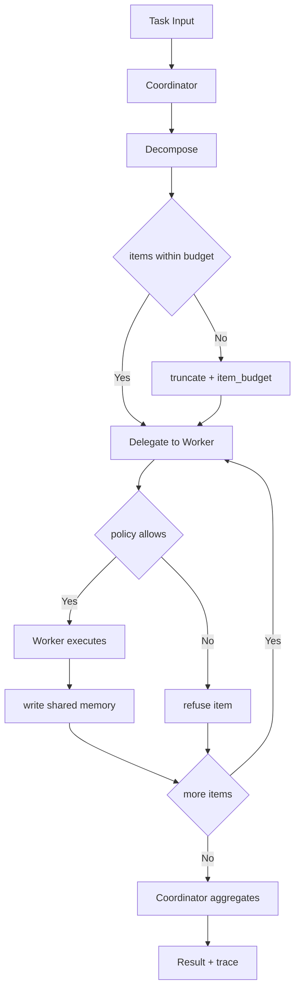

---
# MAM Metadata
id: template-agent
name: Agent Template
version: 2.0.0
type: agent

author: MAM Team

description: >
  Starter template for multi-agent MAM systems: a coordinator that plans and
  delegates, a worker that executes, shared memory, and a safety policy.

license: MIT

runtime:
  language: python
  version: ">=3.12"

tags:
  - template
  - agent
  - multi-agent
  - system

dependencies:
  - name: mam-runtime
    version: ">=1.0.0"

capabilities:
  - orchestrate
  - delegate
  - execute

permissions:
  filesystem:
    - read
  network:
    - internet
  python:
    - sandbox
---

# Agent Module Template

## Purpose

Template for creating a multi-agent system with tools, shared memory and a
safety policy. The coordinator plans, the worker executes, the policy gates every
step and the shared memory carries results between them. Copy this file and
customise the agents, tools and edges for your use case.

## Inputs

| Name | Type | Required | Description |
|------|------|----------|-------------|
| task | string | Yes | Task or goal for the system |
| context | object | No | Optional context shared with all agents |
| max_items | number | No | Maximum work items the coordinator may plan (default 4) |

## Outputs

| Name | Type | Description |
|------|------|-------------|
| result | list | One record per delegated work item |
| agents | list | Names of the agents that participated |
| memory | object | Keys written to shared memory during the run |
| stop_reason | string | `completed`, `no_task`, `refused` or `item_budget` |
| trace | object | Plan size, executed items, refusals and duration |

## Agent Identity

This system is a two-agent assembly: a **Coordinator** that decomposes and
routes, and a **Worker** that executes. They share one memory namespace and one
policy. The system is deliberately small — two agents, two tools, one policy —
because it is the smallest shape that still demonstrates delegation, shared
state and a safety boundary.

The system does not chat, retry or wait. A task becomes a list of work items,
each item becomes a worker result, and the results are aggregated into one
return value with an explicit stop reason.

## Role Description

The Coordinator is the authority on decomposition and routing. The Worker is the
authority on execution. The SafetyPolicy is the authority on what may run at
all. None of them may take over another's responsibility: the worker never
plans, the coordinator never executes, and the policy never rewrites results.

## Profile

| Attribute | Value |
|-----------|-------|
| System ID | `template-agent` |
| Category | `agent` |
| Specialization | Two-agent delegation with shared memory |
| Agents | Coordinator (`Orchestration`), Worker (`Execution`) |
| Tools | `PlannerTool` (plan, schedule, prioritize), `Python` (execute, analyze, transform) |
| Memory | `SharedMemory` — vector, sqlite, workspace scope, 24h TTL |
| Policy | `SafetyPolicy` — allow python/planner, deny shell.rm/network.internal |
| Termination | `completed`, `no_task`, `refused` or `item_budget` |
| Failure mode | Refuse the item, keep the run, report the refusal |

## Capabilities

### orchestrate

Break an incoming task into ordered work items and aggregate the results.

### delegate

Assign each work item to the appropriate agent through a declared edge.

### execute

Run delegated work and return structured results.

## Core Competencies

### 1. Deterministic decomposition

Split the task on `;` and newlines, trim, drop empties, and cap at `max_items`.
The same task always yields the same work items.

### 2. Single-owner delegation

Each work item is assigned to exactly one worker. The coordinator never executes
an item itself.

### 3. Policy gating

Every execution is checked against the allow/deny lists. A denied tool refuses
the item; it does not abort the whole run.

### 4. Shared memory

Agents read and write one namespace. Keys are namespaced per item
(`result:<index>`) so a later item cannot overwrite an earlier result.

### 5. Aggregation

Results are returned in plan order with their status, so the caller can see
partial success without inspecting memory.

### 6. Bounded plans

`max_items` caps decomposition. A task that would produce more items is
truncated and reported as `item_budget`.

### 7. Explicit stop reasons

Every run ends with one of `completed`, `no_task`, `refused` or `item_budget`.

### 8. Unique roles

Agent roles are unique within a system; a duplicate role is a configuration
error, checked before execution.

## Response Format Template

```json
{
  "result": [
    {"task": "summarize the repository", "status": "completed", "output": "summarize the repository: done"}
  ],
  "agents": ["Coordinator", "Worker"],
  "memory": {"result:0": "summarize the repository: done"},
  "stop_reason": "completed",
  "trace": {"planned": 1, "executed": 1, "refused": 0, "duration_ms": 0.2}
}
```

## Decision-Making Framework

| Situation | Decision | Stop reason |
|-----------|----------|-------------|
| Task empty or not a string | Do not plan | `no_task` |
| Planned items exceed `max_items` | Truncate the plan | `item_budget` |
| Tool not allowed or denied | Refuse that item | `refused` (if all refused) |
| Worker returns a failure | Keep the record, continue | unchanged |
| All items executed | Aggregate and return | `completed` |
| Duplicate agent role | Reject the configuration | error |

Ambiguity rule: prefer a smaller plan over a failed run; a refused item is data.

## Communication Style

- **With callers:** one result object; branch on `stop_reason`.
- **With operators:** the trace explains the run without quoting item text.
- **Between agents:** structured handoffs (`{task, index}`), never prose.
- **In logs:** agent names, statuses and counts only.

## Tool Access and Capabilities

| Tool | Owner | Capabilities | Permission |
|------|-------|--------------|------------|
| `PlannerTool` | Coordinator | plan, schedule, prioritize | read |
| `Python` | Worker | execute, analyze, transform | python: sandbox |

## System Definition

module MySystem

type:
    system

agents:
    - Coordinator
    - Worker

edges:
    Coordinator -> Worker

memory:
    shared: SharedMemory

policy:
    SafetyPolicy

## Agent: Coordinator

module Coordinator

type:
    agent

role:
    Orchestration

goal:
    Decompose incoming tasks and delegate them to the appropriate worker agent

memory:
    shared

tools:
    - PlannerTool

handoff:
    - Worker

## Agent: Worker

module Worker

type:
    agent

role:
    Execution

goal:
    Execute delegated tasks and return structured results

memory:
    shared

tools:
    - Python

## Tool: PlannerTool

module PlannerTool

type:
    tool

provider:
    planner

capabilities:
    - plan
    - schedule
    - prioritize

## Tool: Python

module PythonRuntime

type:
    tool

provider:
    python

permissions:
    python: sandbox

capabilities:
    - execute
    - analyze
    - transform

## Memory: SharedMemory

module SharedMemory

type:
    memory

format:
    vector

backend:
    sqlite

scope:
    workspace

ttl:
    24h

## Policy: SafetyPolicy

module SafetyPolicy

type:
    policy

allow:
    - python
    - planner

deny:
    - shell.rm
    - network.internal

permissions:
    filesystem: read
    network: internet
    python: sandbox

## Integration Patterns with Other Agents

- **Coordinator → Worker:** one edge, one direction, structured items.
- **Worker → Coordinator:** results only through shared memory and the return
  value; no direct calls back.
- **Policy:** consulted before every worker execution.
- **Memory:** shared namespace; keys namespaced per item.
- **External systems:** only through the Python tool, inside the sandbox.

## Rules

- Agents must validate all inputs before processing.
- Shared memory is read and write for all agents in the system.
- SafetyPolicy deny rules are enforced at runtime.
- Maximum 10 agents per system.
- Agent roles must be unique within a system.
- The coordinator never executes; the worker never plans.
- A refused item is recorded and the run continues.
- Results are keyed by plan index to avoid collisions.

## Workflow



## Python

```python
import time
from typing import Any, Dict, List, Optional

MAX_AGENTS = 10
MAX_ITEMS = 4

DEFAULT_ALLOW = ("python", "planner")
DEFAULT_DENY = ("shell.rm", "network.internal")


class PolicyError(ValueError):
    """Raised when the system configuration violates the policy contract."""


class SafetyPolicy:
    """Allow/deny gate for tool execution."""

    def __init__(self, allow: Optional[List[str]] = None, deny: Optional[List[str]] = None) -> None:
        self.allow = set(DEFAULT_ALLOW) | set(allow or [])
        self.deny = set(DEFAULT_DENY) | set(deny or [])

    def check(self, tool: str) -> Dict[str, Any]:
        if tool in self.deny:
            return {"allowed": False, "code": "tool_denied"}
        if tool not in self.allow:
            return {"allowed": False, "code": "tool_not_allowed"}
        return {"allowed": True, "code": ""}


class SharedMemory:
    """One namespace shared by every agent in the system."""

    def __init__(self) -> None:
        self.data: Dict[str, Any] = {}

    def set(self, key: str, value: Any) -> Any:
        self.data[key] = value
        return value

    def get(self, key: str, default: Any = None) -> Any:
        return self.data.get(key, default)


class Coordinator:
    """Break a task into work items and delegate execution."""

    role = "Orchestration"
    goal = "Decompose incoming tasks and delegate them to the appropriate worker agent"

    def __init__(self, max_items: int = MAX_ITEMS) -> None:
        if max_items < 1:
            raise ValueError("max_items must be at least 1")
        self.max_items = max_items

    def plan(self, task: str) -> List[str]:
        if not isinstance(task, str) or not task.strip():
            return []
        parts = [part.strip() for part in task.replace("\n", ";").split(";")]
        return [part for part in parts if part][: self.max_items]

    def delegate(self, work_items: List[str], policy: SafetyPolicy,
                 memory: SharedMemory) -> List[Dict[str, Any]]:
        worker = Worker()
        results: List[Dict[str, Any]] = []
        for index, item in enumerate(work_items):
            verdict = policy.check("python")
            if not verdict["allowed"]:
                results.append({"task": item, "status": "refused", "code": verdict["code"]})
                continue
            record = worker.run(item, memory, index)
            results.append(record)
        return results


class Worker:
    """Execute delegated work items and return structured results."""

    role = "Execution"
    goal = "Execute delegated tasks and return structured results"

    def run(self, work_item: str, memory: SharedMemory, index: int = 0) -> Dict[str, Any]:
        output = f"{work_item}: done"
        memory.set(f"result:{index}", output)
        return {"task": work_item, "status": "completed", "output": output}


def validate_system(agents: List[Dict[str, str]]) -> None:
    if len(agents) > MAX_AGENTS:
        raise PolicyError(f"at most {MAX_AGENTS} agents are allowed")
    roles = [agent.get("role", "") for agent in agents]
    if len(roles) != len(set(roles)):
        raise PolicyError("agent roles must be unique")


SYSTEM_AGENTS = [
    {"name": "Coordinator", "role": "Orchestration"},
    {"name": "Worker", "role": "Execution"},
]


def orchestrate(task: str, max_items: int = MAX_ITEMS,
                policy: Optional[SafetyPolicy] = None,
                memory: Optional[SharedMemory] = None) -> Dict[str, Any]:
    started = time.perf_counter()
    validate_system(SYSTEM_AGENTS)
    policy = policy or SafetyPolicy()
    memory = memory or SharedMemory()

    coordinator = Coordinator(max_items=max_items)
    items = coordinator.plan(task)
    if not items:
        return {
            "result": [], "agents": ["Coordinator", "Worker"], "memory": {},
            "stop_reason": "no_task",
            "trace": {"planned": 0, "executed": 0, "refused": 0,
                      "duration_ms": round((time.perf_counter() - started) * 1000, 3)},
        }

    results = coordinator.delegate(items, policy, memory)
    refused = [r for r in results if r["status"] == "refused"]
    executed = [r for r in results if r["status"] == "completed"]
    if refused and not executed:
        stop_reason = "refused"
    elif len(items) >= max_items:
        stop_reason = "item_budget"
    else:
        stop_reason = "completed"

    return {
        "result": results,
        "agents": ["Coordinator", "Worker"],
        "memory": dict(memory.data),
        "stop_reason": stop_reason,
        "trace": {
            "planned": len(items),
            "executed": len(executed),
            "refused": len(refused),
            "duration_ms": round((time.perf_counter() - started) * 1000, 3),
        },
    }
```

## Tests

### Input

```yaml
task: summarize the repository
```

### Expected

```yaml
result: one completed entry
agents:
  - Coordinator
  - Worker
```

```python
def test_orchestrate():
    output = orchestrate("summarize the repository")
    assert output["agents"] == ["Coordinator", "Worker"]
    assert output["result"][0]["status"] == "completed"
    assert output["stop_reason"] == "completed"
    assert output["memory"] == {"result:0": "summarize the repository: done"}


def test_empty_task():
    output = orchestrate("")
    assert output["result"] == []
    assert output["stop_reason"] == "no_task"
    assert output["trace"]["planned"] == 0


def test_plan_splits_on_semicolons_and_newlines():
    coordinator = Coordinator()
    assert coordinator.plan("a; b\nc") == ["a", "b", "c"]


def test_item_budget_truncates():
    output = orchestrate("a; b; c; d; e", max_items=2)
    assert len(output["result"]) == 2
    assert output["stop_reason"] == "item_budget"


def test_policy_deny_refuses_all_items():
    policy = SafetyPolicy(allow=["planner"], deny=["python"])
    output = orchestrate("one item", policy=policy)
    assert output["stop_reason"] == "refused"
    assert output["result"][0]["code"] == "tool_denied"


def test_unknown_tool_is_refused():
    assert SafetyPolicy().check("shell.rm")["code"] == "tool_denied"
    assert SafetyPolicy().check("unknown.tool")["code"] == "tool_not_allowed"


def test_roles_must_be_unique():
    try:
        validate_system([{"name": "A", "role": "Same"}, {"name": "B", "role": "Same"}])
    except PolicyError:
        return
    raise AssertionError("expected PolicyError")


def test_memory_is_shared_and_namespaced():
    memory = SharedMemory()
    output = orchestrate("first; second", memory=memory)
    assert memory.data == {"result:0": "first: done", "result:1": "second: done"}
    assert set(output["memory"]) == {"result:0", "result:1"}


def test_output_is_deterministic():
    first = orchestrate("one; two")
    second = orchestrate("one; two")
    first["trace"].pop("duration_ms")
    second["trace"].pop("duration_ms")
    assert first == second
```

## Examples

### Plan, delegate and stop an agent run

```python
system = {
    "name": "MySystem",
    "agents": ["Coordinator", "Worker"],
    "memory": "SharedMemory",
    "policy": "SafetyPolicy",
}
output = orchestrate("summarize the repository")
print(output["agents"])
print(output["stop_reason"])

result = orchestrate("collect metrics; summarize metrics", max_items=3)
print(result["memory"])
```

### Expected Flow

```text
Input -> Coordinator -> Worker -> Aggregate -> Output
```

## Best Practices

- Keep the graph acyclic; the coordinator is the only planner.
- Namespace shared-memory keys by plan index.
- Gate every worker execution through the policy, not just the coordinator.
- Return partial results with a stop reason instead of failing the run.
- Test duplicate roles and denied tools explicitly.

## Common Anti-Patterns

- **Worker planning.** Two planners produce contradictory plans.
- **Coordinator executing.** It hides work that the policy never saw.
- **Unbounded fan-out.** Cap `max_items` or the system becomes a fork bomb.
- **Global memory keys.** `result` overwritten by every item.
- **Policy applied once.** Each execution needs its own check.

## Performance Optimization Patterns

- Plan once per task; never re-plan between items.
- Delegate sequentially unless the worker is explicitly safe to parallelise.
- Keep memory as a dict; avoid serialising between agents.
- Build the trace from counters; do not scan results twice.
- Target is under 20 ms for four items.

## Security Considerations

- The policy deny list is a floor; the host sandbox is the real boundary.
- Never pass raw task text into a shell; the Python tool is sandboxed.
- Refusals must be reported, not swallowed.
- Shared memory is readable by every agent: never store secrets there.
- Validate agent configuration before running anything.

## Troubleshooting Guide

| Symptom | Likely cause | Action |
|---------|--------------|--------|
| Empty result with non-empty task | plan split ate the text | check separators |
| Everything refused | policy allow list missing a tool | add the tool or fix the deny |
| `item_budget` constantly | `max_items` too low | raise it or split the task upstream |
| Memory missing keys | policy refused before write | inspect `result[].code` |
| Duplicate-role error | copy-paste in agents | give each role a distinct name |

## Quick Reference Card

- Coordinator plans; Worker executes; Policy gates; Memory is shared.
- Two agents, two tools, one policy.
- Separators: `;` and newlines, max 4 items.
- Stop reasons: `completed`, `no_task`, `refused`, `item_budget`.
- Keys: `result:<index>`.

## References

- [MAM Agent Specification](../../../spec/sections/)
- [Basic agent template](./agent-basic.mam)
- [Advanced agent template](./agent-advanced.mam)
- [MAM Specification](../../../plan-doc/full-mam.md)
